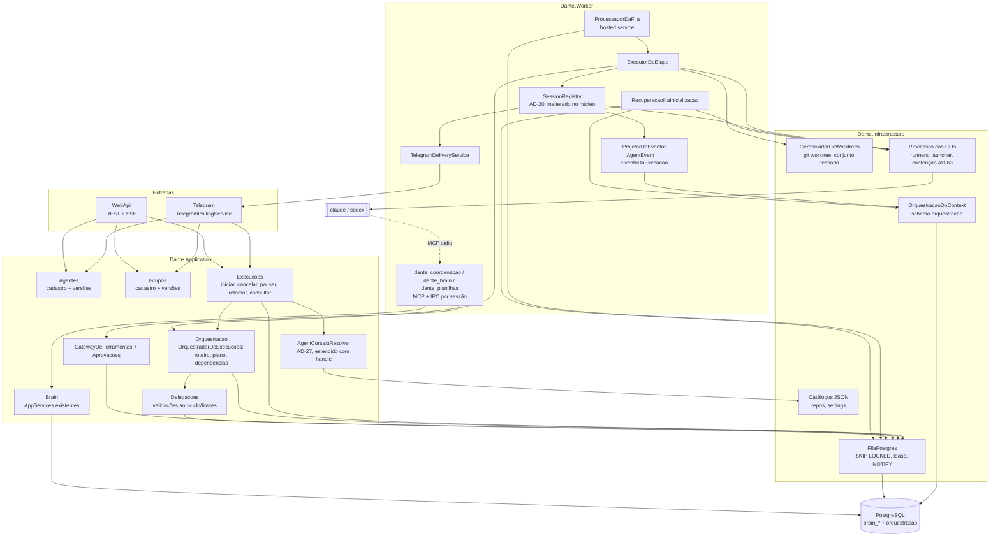

# Arquitetura proposta

Monólito modular local, como hoje (AD-35): um Worker que executa, uma WebApi que lê e enfileira, um PostgreSQL que
guarda o trabalho. Sem microserviços, broker, Kubernetes ou workers remotos.

## Visão geral dos componentes



## Responsabilidades por camada

| Camada | Recebe | Não recebe |
| --- | --- | --- |
| **Domain** (`Agentes`, `Grupos`, `Execucoes`, `Delegacoes`, `Aprovacoes`) | Entidades, versões imutáveis, máquinas de estado, invariantes (DAG, limites, papéis), cálculo de hash canônico | EF, Npgsql, Telegram, processos |
| **Application** (features `Agentes`, `GruposDeAgentes`, `Execucoes`, `Orquestracao`, `Delegacoes`, `Aprovacoes`, `GatewayDeFerramentas`) | Casos de uso, portas (`IFilaDeTrabalho`, `IRegistroDeExecucoes`, `IGerenciadorDeWorktrees`, `IExecutorDeAgentes`), validators, DTOs, projeções | SQL, detalhes de CLI |
| **Infrastructure** | `OrquestracaoDbContext`, repositories, `FilaPostgres`, `GerenciadorDeWorktreesGit`, adapters de execução (envolvem runners e launcher existentes), migrations | Regras de orquestração |
| **Worker** | Hosted services (fila, recuperação, heartbeat), `ExecutorDeEtapa` que liga orquestração ao `SessionRegistry` vivo, MCP/IPC, Telegram, projetor de eventos | Regras de negócio novas |
| **WebApi** | Consultas e comandos (via casos de uso → fila), SSE de eventos, autenticação | Execução de agentes, processos |

O legado de sessões continua no Worker (AD-35/38). `ExecutorDeEtapa` fica no Worker porque depende do
`SessionRegistry`; quando sessões migrarem de camada, ele migra junto. Isso evita mover as ~4 400 linhas de
`Worker/Sessions` como pré-requisito.

## Serviços e interfaces principais (ilustrativos)

```csharp
// Application/Execucoes
public interface IExecucoesAppService
{
    Task<ExecucaoCriadaDto> IniciarAsync(PedidoDeExecucao pedido, CancellationToken ct);   // Tarefa, Roteiro, Coordenada, Avulsa
    Task CancelarAsync(long numero, string motivo, AutoridadeDto autor, CancellationToken ct);
    Task PausarAsync(long numero, AutoridadeDto autor, CancellationToken ct);
    Task RetomarAsync(long numero, AutoridadeDto autor, CancellationToken ct);
    Task<ExecucaoDetalhadaDto?> ObterAsync(long numero, AutoridadeDto autor, CancellationToken ct);
    Task<IReadOnlyList<ExecucaoResumoDto>> ListarAsync(FiltroDeExecucoes filtro, AutoridadeDto autor, CancellationToken ct);
}

public sealed record PedidoDeExecucao(
    AlvoDaExecucao Alvo,              // Agente(handle) | Grupo(nome) | Driver(AgentKind) para /claude, /codex
    string Objetivo,
    ContextoResolvidoDto Contexto,    // resultado do AgentContextResolver (AD-27/58)
    AutoridadeDto Autoridade,
    string? ChaveDeIdempotencia);     // ex.: id da mensagem do Telegram, para não duplicar em reentrega

// Application/Orquestracao — puro, testável sem processos
public interface IOrquestradorDeExecucoes
{
    // Decide o que fazer depois de um fato: concluir etapa, aprovar, responder delegação, expirar.
    DecisaoDeAvanco Avancar(EstadoDaExecucaoCompleto estado, FatoDaExecucao fato);
}

// Application/Execucoes/Portas
public interface IFilaDeTrabalho
{
    void Enfileirar(TrabalhoNovo trabalho);                                   // na transação do UoW corrente
    Task<TrabalhoReivindicado?> ReivindicarAsync(IdentidadeDoTrabalhador eu, CancellationToken ct);
    Task<bool> RenovarAsync(TrabalhoReivindicado trabalho, CancellationToken ct);
    Task DevolverAsync(TrabalhoReivindicado trabalho, TimeSpan espera, CancellationToken ct);
}

public interface IExecutorDeAgentes      // implementado no Worker sobre SessionRegistry/runners existentes
{
    Task<ResultadoDeEtapa> ExecutarAsync(EtapaParaExecutar etapa, CancellationToken ct);
}

public interface IGerenciadorDeWorktrees
{
    Task<WorktreeReservada> ReservarAsync(Guid idExecucao, RepositorioCadastrado repositorio, string branch, string baseRef, CancellationToken ct);
    Task LiberarAsync(Guid idReserva, bool remover, CancellationToken ct);   // remover só sem alterações não enviadas
    Task<IReadOnlyList<WorktreeObservada>> ListarAsync(RepositorioCadastrado repositorio, CancellationToken ct);
}

// Worker/Sessions — porta nova consumida pelo SessionRegistry, implementação nula sem banco
public interface IRegistroDeSessoes
{
    Task RegistrarInicioAsync(AgentSessionSnapshot sessao, Guid? idVersaoDoAgente, Guid? idEtapa, CancellationToken ct);
    Task RegistrarFimAsync(string codigoSessao, AgentSessionState estado, string? motivo, CancellationToken ct);
}
```

## Eventos

### Persistidos (`EventoDaExecucao`)

| Grupo | Tipos |
| --- | --- |
| Execução | `ExecucaoCriada`, `EstadoDaExecucaoAlterado`, `ExecucaoConcluida`, `ExecucaoFalhou`, `ExecucaoCancelada`, `ExecucaoInterrompida`, `ExecucaoRetomada` |
| Etapa | `EtapaPronta`, `EtapaIniciada` (agente, sessão), `EtapaConcluida` (resumo, uso), `EtapaFalhou`, `EtapaInterrompida` |
| Plano e delegação | `PlanoProposto`, `PlanoValidado`, `PlanoRecusado`, `DelegacaoCriada`, `DelegacaoRespondida`, `DelegacaoExpirada` |
| Aprovação | `AprovacaoSolicitada`, `AprovacaoDecidida`, `AcaoAprovadaExecutada`, `AprovacaoDaCliRegistrada` |
| Agente e sessão | `SessaoIniciada`, `SessaoEncerrada`, `TurnoConcluido` (resultado redigido, uso de tokens), `FerramentaUsada` (identidade AD-57, sem argumentos sensíveis) |
| Worktree | `WorktreeCriada`, `WorktreeLiberada`, `EstadoDoCheckoutObservado` |

Cada evento: `sequencia` global, `IdExecucao`, `IdExecucaoRaiz`, `Tipo`, `Autor`, `OcorridoEm`, `Dados` (JSON
pequeno, redigido). **Deltas de streaming não são persistidos**; continuam só no runtime (AD-21/23).

### Tempo real

- **Worker → Telegram**: o `ProjetorDeEventos` publica num sink em memória; o `TelegramDeliveryService` recebe os
  eventos de execução por um adaptador novo, sem mudar o fluxo de sessão;
- **Worker → WebApi**: processos distintos. Após o commit, `NOTIFY dante_eventos, '<sequencia>'`; a WebApi escuta
  e repassa por **SSE** (`GET /execucoes/{numero}/eventos`, `GET /eventos?desde=<sequencia>`). Reconexão por
  `Last-Event-ID` = `sequencia`: o cliente nunca perde evento, porque relê do banco. SSE é suficiente (fluxo
  servidor → cliente; comandos vão por POST). SignalR só se o chat precisar de bidirecional de baixa latência;
- **Streaming de texto ao vivo na web** (deltas): fora da primeira versão do chat; quando entrar, sai do Worker
  para a WebApi por um canal efêmero (NOTIFY com payload pequeno ou IPC local), nunca pelo ledger.

## Chat e interface

O chat é **interface**, não coordenação. Contratos que a WebApi precisa (todos sobre casos de uso existentes):

| Necessidade | Contrato |
| --- | --- |
| Conversar com um agente | `POST /conversas` (alvo agente) → sessão; `POST /conversas/{id}/mensagens` → trabalho `EnviarMensagemParaSessao`; resposta pelos eventos `TurnoConcluido` |
| Conversar com um grupo | `POST /conversas` (alvo grupo); cada mensagem → `Execucao` Roteiro/Coordenada ligada à conversa |
| Iniciar execução | `POST /execucoes` (`PedidoDeExecucao`) |
| Acompanhar etapas, participantes, delegações | `GET /execucoes/{n}` (árvore: etapas, filhas, delegações, sessões, versões) + SSE |
| Aprovações | `GET /aprovacoes?pendentes`, `POST /aprovacoes/{id}/decisao` |
| Interromper | `POST /execucoes/{n}/cancelar|pausar|retomar` |
| Resultados e conversas anteriores | `GET /execucoes?…`, `GET /conversas/{id}` (do ledger; transcript upstream não existe) |
| Agentes e grupos | `GET/POST/PATCH /agentes`, `/grupos` (cria versões) |

Autenticação da WebApi é pré-requisito do chat e decisão própria (hoje só existe a allowlist do Telegram). A WebApi
continua sem executar agentes: comandos viram trabalhos na fila, e o Worker executa. Isso respeita o limite
"sem entrada HTTP funcional que execute agentes" no espírito (o HTTP não lança processo), mas **muda** o limite
declarado em PROJECT_CONTEXT — por isso entra como AD proposta.

## Fronteira com o Brain

A divisão proposta pelo mantenedor é adotada sem ajustes de responsabilidade:

| Componente | Responsável por | Não faz |
| --- | --- | --- |
| **Brain** | conhecimento, memória, recuperação de contexto, relações (AD-33…65) | planejar, delegar, decidir quem executa, guardar estado de execução |
| **Orquestrador** | planejamento validado, delegação, coordenação, dependências, execução | guardar conhecimento; decidir verdade de conteúdo |
| **Agentes** | tarefas especializadas | conceder permissões a si mesmos |
| **Sessões** | contexto conversacional vivo de um agente | sobreviver ao processo |
| **Execuções** | estado persistente do trabalho | servir de memória de longo prazo |

Pontos de contato, todos já existentes ou mínimos:

- agentes de qualquer execução recebem `dante_brain` conforme a concessão da versão (AD-56), no espaço do usuário
  da raiz;
- o pacote de contexto do Brain (AD-46) pode compor o prólogo de uma etapa; o **estado da execução** (o que foi
  delegado, resultados das etapas) vem do ledger, nunca do Brain;
- resultados de execução só viram conhecimento pela captura existente (candidato + confirmação, #157/AD-61);
- nenhuma otimização de recuperação nova é proposta; a #147 não é reaberta.

Uma ressalva: "memória do agente" (conhecimento só de um agente) **não** é necessária na primeira versão; o espaço
do usuário já é o limite. Se surgir, entra como recorte de escopo no Brain, não como memória do orquestrador.
