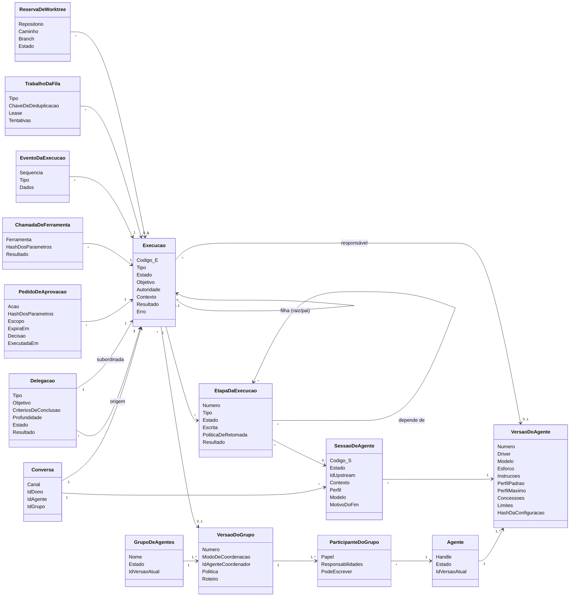

# Modelo de domínio

Proposta. Nomes em PT-BR conforme AD-36; toda entidade persistente herda `EntidadeBase` (Guid gerado pelo
domínio). Os contratos C# ilustram a proposta e **não** devem ser implementados antes da aprovação.

## Os três conceitos centrais

| Conceito | O que é | Vida | Fonte de verdade |
| --- | --- | --- | --- |
| **Agente** | Identidade reutilizável e configurável: quem é, o que pode, com qual CLI e modelo | Meses; muda por versões | PostgreSQL (`Agente` + `VersaoDoAgente`) |
| **Sessão de agente** | Uma conversa upstream viva com **um** agente: um processo da CLI, um `session_id`/`thread.id` | Minutos a horas; morre com o processo | Runtime em memória (`SessionRegistry`, AD-20); **metadados** no PostgreSQL |
| **Execução** | Uma unidade de trabalho rastreável com objetivo, estado, etapas e resultado | Até concluir, falhar ou ser cancelada; sobrevive a reinícios | PostgreSQL (`Execucao` + `EtapaDaExecucao`) |

Regras de relação:

- uma **sessão pertence a exatamente um agente** (uma versão). Duas CLIs não compartilham sessão upstream, e
  dois agentes registrados não compartilham processo, mesmo usando o mesmo driver e modelo;
- uma **execução pode usar zero, uma ou várias sessões** (uma por etapa ou por participante), e uma sessão pode
  servir a várias execuções ao longo da vida (conversa com o coordenador de um grupo);
- uma **conversa com um grupo** não é uma sessão: é uma `Conversa` (canal do usuário) que referencia as execuções
  e as sessões dos participantes;
- **turno não é execução**. A conversa comum (AD-23) continua leve: mensagem → turno da sessão ativa. Um turno só
  se liga a uma execução quando executa uma etapa dela.



## Agente

### Campos

| Campo | Onde | Regra |
| --- | --- | --- |
| `Id` | `Agente` | Guid estável |
| `Handle` | `Agente` | Único, minúsculo, `[a-z][a-z0-9-]{1,30}`, imutável. **Sem `@`**: na AD-27 `@` já é repositório |
| `Nome`, `Descricao` | `Agente` | Texto de apresentação; não concede nada |
| `Estado` | `Agente` | `Ativo`, `Desativado`, `Arquivado` |
| `IdVersaoAtual` | `Agente` | Aponta para a versão vigente |
| `Driver` | `VersaoDoAgente` | `AgentKind` (`Claude`, `Codex`). **Provider é derivado do driver** (Claude Code → Anthropic, Codex → OpenAI) enquanto só houver CLIs; um driver por API entraria como novo valor e nova AD |
| `Modelo`, `Esforco` | `VersaoDoAgente` | `AgentModelSelection`, validado no `AgentModelCatalog` (AD-25/26) ao salvar **e** ao iniciar; nulo = padrão da CLI |
| `Instrucoes` | `VersaoDoAgente` | Texto de papel; entra como `ContextInstructions` da sessão, **depois** do `ContratoDaConversaParaAgentes` e sem poder revogá-lo |
| `Capacidades` | `VersaoDoAgente` | Etiquetas declaradas (`implementar`, `revisar`, `pesquisar`, `planejar`). Servem a validação de papéis e ao coordenador; não concedem permissão |
| `PerfilPadrao`, `PerfilMaximo` | `VersaoDoAgente` | `AgentPermissionProfile`. A sessão pode restringir, nunca ampliar acima do máximo. `full` continua inexistente (AD-22/24) |
| `Concessoes` | `VersaoDoAgente` | Servidores de ferramentas do D.A.N.T.E. permitidos (`dante_brain` leitura/escrita, `dante_planilhas`, `dante_coordenacao`) e repositórios permitidos (aliases ou "qualquer") |
| `PodeEscrever` | `VersaoDoAgente` | Falso → só perfil `plan` e etapas de leitura |
| `PodeConsultar` | `VersaoDoAgente` | Handles que este agente pode consultar fora de um grupo ([DELEGATION](DELEGATION.md#validações-determinísticas-no-caso-de-uso-antes-de-qualquer-processo)); vazio = nenhum |
| `LimitesDeAutonomia` | `VersaoDoAgente` | Máx. delegações por execução, profundidade, turnos por etapa, duração por etapa |
| `LimitesDeConsumo` | `VersaoDoAgente` | Tokens por execução (quando a CLI informa, `AgentTokenUsage`), execuções simultâneas. Custo em dinheiro não se aplica às assinaturas (AD-31) e fica fora |
| `HashDaConfiguracao` | `VersaoDoAgente` | SHA-256 do JSON canônico da versão; identifica reprodutibilidade |

### Versionamento

- toda edição que muda comportamento cria `VersaoDoAgente` nova, **imutável**, com `Numero` sequencial;
- `Execucao`, `EtapaDaExecucao` e `SessaoDeAgente` guardam `IdVersaoDoAgente`, nunca só `IdAgente`: uma execução
  antiga é reproduzível pela versão, e uma edição não muda o que já está rodando (mesmo princípio da AD-11 e AD-20);
- reprodução exata é limitada pelo que está fora do D.A.N.T.E.: versão da CLI e do modelo upstream. A versão
  registra também a versão da CLI observada ao iniciar a sessão (em `SessaoDeAgente`), para diagnóstico;
- nome e descrição mudam no `Agente` sem nova versão.

### Ciclo de vida

```text
Ativo ──desativar──▶ Desativado ──arquivar──▶ Arquivado
  ▲                      │
  └──────reativar────────┘
```

- **Desativar**: nenhuma sessão, execução ou delegação nova; as ativas seguem até o fim ou até cancelamento
  explícito (mesma postura da AD-58 para `unlink`). A resposta lista o que ainda está ativo;
- **Arquivar**: só sem execução ativa; o handle não é reutilizado; versões ficam para histórico;
- **Remover fisicamente**: não existe enquanto houver referência; é exportação/limpeza administrativa futura.

### Agentes embutidos

`claude` e `codex` existem como agentes embutidos, não editáveis, cuja versão é **materializada no início de
cada execução** a partir das preferências atuais do usuário (`/model`, `/effort`, `/mode`, AD-24/25/26). Assim
`/claude`, `/codex`, `/agent set` e a conversa session-first continuam idênticos, e passam a ter versão registrada.

## Sessão de agente

- **Runtime**: continua `AgentSession` + `SessionRegistry` (AD-16/20) — dono, contexto fixo, uma ativa por usuário,
  fila do D.A.N.T.E., steer explícito. Nada disso muda;
- **Registro persistido** (`SessaoDeAgente`): código `S…`, dono, versão do agente, contexto congelado, perfil,
  modelo, id upstream, PID e unidade de contenção, estado, criação, fim e motivo do fim, `IdConversa` e
  `IdExecucao` quando a sessão foi aberta para uma execução;
- **Contexto conversacional**: vive no processo upstream. O D.A.N.T.E. não guarda transcript; guarda eventos-chave
  (turnos, ferramentas, approvals, resultado final do turno, uso de tokens), conforme a política de eventos;
- **Várias sessões do mesmo agente**: permitidas, como hoje (S… distintos). Limite por versão de agente
  (`LimitesDeConsumo.ExecucoesSimultaneas`) e global;
- **Conflito de estado**: cada sessão continua serializando operações upstream (`Upstream` semaphore, AD-22/24);
  escrita no mesmo diretório por duas sessões é resolvida por reserva de worktree, não pela sessão
  ([PERSISTENCE_AND_EXECUTIONS](PERSISTENCE_AND_EXECUTIONS.md#worktrees-e-concorrência));
- **Reinício do Worker**: o processo morre (ou é parado pela varredura de scopes). O registro passa a
  `Interrompida` com motivo "reinício do Worker". `S…` antigo deixa de ser "não encontrada" e passa a mostrar
  o que era. **Não há retomada automática da conversa upstream** na primeira fase: Codex usa thread efêmera
  (AD-19) e `thread/resume` recusou threads efêmeras (AD-24). Continuidade vem do Brain (AD-46) e do ledger
  (resumo da execução). Retomar com `claude --resume` / thread não efêmera é spike futuro, não pré-requisito;
- **Compatibilidade**: códigos `S…`, `T…`, `R…` e `J…` continuam no Telegram. Com ledger ativo, os contadores
  passam a vir de sequências do banco para não colidirem após reinício.

## Execução

### Tipos

| Tipo | Origem | Exemplo |
| --- | --- | --- |
| `Avulsa` | `/claude`, `/codex`, fallback one-shot | o job de hoje (AD-06), agora persistido |
| `Tarefa` | pedido explícito a um agente | `/tarefa revisor @dante revise o PR 301` |
| `Roteiro` | pedido a um grupo com roteiro fixo | implementar → revisar → corrigir → aprovação humana |
| `Coordenada` | pedido a um grupo com coordenador | coordenador planeja, delega e consolida |
| `Delegada` | ferramenta de delegação | subordinada a uma execução de origem |
| `Rotina` | agendamento (fase final) | relatório diário |

### Campos

```csharp
public sealed class Execucao : EntidadeBase
{
    public long Numero { get; private set; }                 // código "E123" para Telegram/chat, sequência do banco
    public TipoDeExecucao Tipo { get; private set; }
    public EstadoDaExecucao Estado { get; private set; }
    public Guid? IdVersaoDoAgente { get; private set; }      // responsável (Avulsa, Tarefa, Delegada)
    public Guid? IdVersaoDoGrupo { get; private set; }       // Roteiro, Coordenada
    public Guid? IdConversa { get; private set; }
    public Guid? IdExecucaoPai { get; private set; }
    public Guid IdExecucaoRaiz { get; private set; }         // ela mesma quando é raiz
    public int Profundidade { get; private set; }
    public AutoridadeDaExecucao Autoridade { get; private set; } // pessoa na raiz + origem (Telegram, WebApi, Delegacao, Rotina)
    public string Objetivo { get; private set; } = "";       // tarefa original, redigida
    public ContextoCongelado Contexto { get; private set; } = null!; // JobExecutionContext serializado + vinculados (AD-11/58)
    public ResultadoDaExecucao? Resultado { get; private set; }
    public ErroDaExecucao? Erro { get; private set; }
    public string? MotivoDoCancelamento { get; private set; }
    public DateTimeOffset CriadaEm { get; private set; }
    public DateTimeOffset? IniciadaEm { get; private set; }
    public DateTimeOffset? ConcluidaEm { get; private set; }
    // Concorrência otimista por xmin (AD-43); transições são métodos que validam o estado de origem.
}
```

Etapas, dependências, delegações, aprovações, eventos e reservas são entidades próprias ligadas por
`IdExecucao` (ver diagrama). Estados e transições:
[PERSISTENCE_AND_EXECUTIONS](PERSISTENCE_AND_EXECUTIONS.md#estados).

## Grupo

Ver [AGENT_GROUPS](AGENT_GROUPS.md). Resumo: `GrupoDeAgentes` + `VersaoDoGrupo` imutável (coordenador,
participantes com papel e responsabilidades, política, roteiro opcional). Execução guarda `IdVersaoDoGrupo`.

## Conversa

Canal do usuário com um agente ou um grupo (Telegram privado hoje; chat web depois). Guarda dono, alvo (agente ou
grupo), sessões e execuções ligadas e a mensagem final de cada execução. **Não orquestra**: é por onde o pedido
entra e o resultado sai. No Telegram, a primeira fase dispensa `Conversa` explícita (o chat privado é a conversa);
a entidade nasce com o chat web.

## Autoridade

Toda execução carrega quem está por trás dela: `IdUsuario` da pessoa na raiz (identidade resolvida pelo adapter,
como na AD-45), `TelegramUserId` operacional, e a origem. Delegadas herdam a pessoa da raiz e **nunca** ampliam
permissões: a interseção entre o que a pessoa autorizou, o que a versão do agente destinatário pode e o que a
política do grupo permite.

## Glossário curto

| Termo | Não confundir com |
| --- | --- |
| Agente (registrado) | `AgentKind` (o driver/CLI) e o "agente/worker" do contrato de desenvolvimento |
| Sessão de agente | Conversa (canal do usuário) e Execução (trabalho) |
| Execução | Job (`Avulsa` é o job de hoje) e Turno (unidade do protocolo da CLI) |
| Etapa | Turno: uma etapa pode levar vários turnos |
| Delegação | Mensagem entre agentes: delegação é linha rastreada com estado e resultado |
