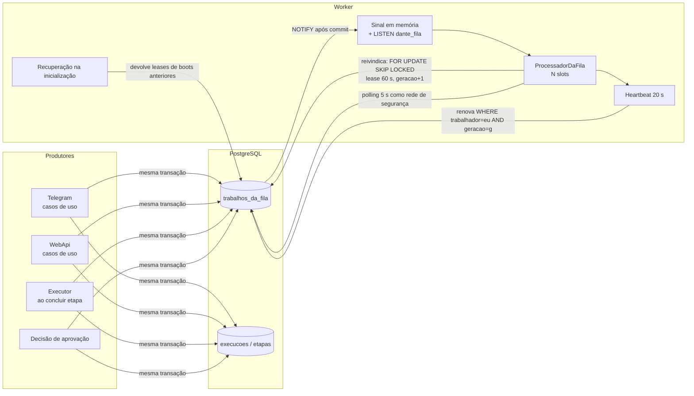

# Fila durável

## Alternativas comparadas

| Alternativa | Prós | Contras | Veredito |
| --- | --- | --- | --- |
| **A. Só memória** (`Channel<T>`) + estado persistido; na inicialização, varrer execuções `Pendente` | Mínima; o Worker é instância única | Sem timers duráveis (expiração de aprovação, backoff); WebApi não consegue enfileirar; ordem e dedupe ad hoc | Insuficiente assim que a WebApi e as aprovações persistidas existirem |
| **B. Lease direto na linha da execução** (`execucoes.lease_ate`) | Uma tabela a menos | Mistura estado de negócio com mecânica; execução esperando aprovação não tem "trabalho"; timers e entregas não cabem | Rejeitada |
| **C. Tabela de trabalhos no PostgreSQL** (outbox transacional, `FOR UPDATE SKIP LOCKED`, lease, dedupe, `disponivel_em`) | Enfileira na mesma transação da mudança de estado; timers e retries duráveis; produtores múltiplos (Worker, WebApi); sem dependência nova | Polling ou `LISTEN/NOTIFY`; exige cuidado para não segurar transação durante a chamada à CLI | **Recomendada** |
| **D. Biblioteca (Hangfire, Quartz) com storage Postgres** | Pronta | Pacote novo e modelo próprio de jobs que não conhece o estado da execução; opaca para auditoria; o contrato pede não adicionar pacotes sem necessidade | Rejeitada |
| **E. Broker (RabbitMQ, Redis, NATS)** | Escala | Novo serviço para operar num host único; dupla escrita banco + broker; vetado pela #296 sem necessidade comprovada | Rejeitada |
| **F. SQLite local para a orquestração** | Sem servidor; não depende do banco do Brain | Segundo motor de banco para operar e fazer backup; sem `SKIP LOCKED` nem `LISTEN/NOTIFY`; escrita concorrente Worker + WebApi limitada; o PostgreSQL já é operado para o Brain | Rejeitada |

## Modelo recomendado (C)

`trabalhos_da_fila`:

| Coluna | Uso |
| --- | --- |
| `id` | Guid |
| `tipo` | `AvancarExecucao`, `ExpirarAprovacao`, `ExpirarPergunta`, `EntregarEvento`, `RetomarExecucao`, `EnviarMensagemParaSessao` (chat web) |
| `id_execucao` | quando aplicável |
| `dados` | JSON pequeno (ids, nunca conteúdo sensível) |
| `chave_de_deduplicacao` | única; ex.: `avancar:E123:etapa3:t1`, `expirar:aprovacao:<id>` |
| `estado` | `pendente`, `reivindicado`, `concluido`, `falhou`, `descartado` |
| `prioridade` | menor primeiro; interativo antes de rotina |
| `disponivel_em` | timers e backoff |
| `tentativas`, `max_tentativas` | retries |
| `trabalhador`, `boot_do_trabalhador` | quem reivindicou (host + PID + Guid do boot) |
| `lease_ate` | expiração do lease |
| `geracao` | *fencing token*: incrementa a cada reivindicação |
| `ultimo_erro` | tipo do erro, sem conteúdo |

### Diagrama



### Reivindicação

```sql
WITH proximo AS (
  SELECT id
  FROM orquestracao.trabalhos_da_fila
  WHERE (estado = 'pendente' AND disponivel_em <= now())
     OR (estado = 'reivindicado' AND lease_ate < now())
  ORDER BY prioridade, disponivel_em
  FOR UPDATE SKIP LOCKED
  LIMIT 1)
UPDATE orquestracao.trabalhos_da_fila t
SET estado = 'reivindicado', trabalhador = @trabalhador, boot_do_trabalhador = @boot,
    lease_ate = now() + interval '60 seconds', geracao = t.geracao + 1, tentativas = t.tentativas + 1
FROM proximo
WHERE t.id = proximo.id
RETURNING t.id, t.tipo, t.id_execucao, t.dados, t.geracao;
```

A transação da reivindicação termina aí. **Nenhuma transação fica aberta durante a chamada à CLI** — a lição da
ADR 0163 do concorrente vale aqui.

## Respostas às perguntas do spike

1. **Como uma execução entra na fila?** O caso de uso grava `execucao` (`Pendente`), suas etapas e um trabalho
   `AvancarExecucao` com chave de deduplicação **na mesma transação** (UoW). Após o commit, sinal em memória
   (mesmo processo) e `NOTIFY dante_fila` (outro processo, ex.: WebApi).
2. **Como o Worker reivindica?** `ProcessadorDaFila` (hosted service) com N slots (limite global) executa o SQL
   acima; antes de executar uma etapa, confere os limites por agente/repositório; se não couber, devolve o trabalho
   com `disponivel_em = now() + 2 s` sem contar tentativa.
3. **Como evitar dois Workers na mesma tarefa?** `SKIP LOCKED` na reivindicação; lease com `geracao`; toda gravação
   de resultado faz CAS em `estado` + `tentativa` da etapa e em `geracao` do trabalho. Um processo que perdeu o
   lease não consegue confirmar nada. Na prática há um Worker por host (systemd), mas a regra também protege
   sobreposição em reinício manual, testes e a WebApi.
4. **Como identificar execução abandonada?** Trabalho `reivindicado` com `lease_ate < now()`; ou, na inicialização,
   reivindicado por `boot_do_trabalhador` diferente do atual no mesmo host — devolvido imediatamente.
5. **Como renovar um lease?** Heartbeat a cada 20 s enquanto a etapa roda:
   `UPDATE … SET lease_ate = now() + 60 s WHERE id = @id AND trabalhador = @eu AND geracao = @g`. Zero linhas →
   lease perdido → cancelar a etapa localmente (o token interrompe o turno/processo) e não gravar resultado.
6. **Processo morre durante a CLI?** Ver [PERSISTENCE_AND_EXECUTIONS](PERSISTENCE_AND_EXECUTIONS.md#o-que-acontece-quando-o-processo-morre-durante-a-chamada-à-cli):
   etapa `Interrompida`, scope parado na recuperação, retomada pela política da etapa.
7. **Evitar executar de novo uma ação concluída?** Chave de idempotência da etapa, CAS de conclusão, dedupe do
   trabalho e `executada_em` das ações aprovadas.
8. **Registrar resultado antes de avançar?** A conclusão da etapa, a transição da execução, o evento e o próximo
   trabalho são uma única transação; o trabalho atual é marcado `concluido` nela também.
9. **Tarefas com aprovação humana?** A execução vai a `AguardandoAprovacao`, **sem lease e sem processo**; o único
   trabalho pendente é `ExpirarAprovacao` com `disponivel_em = expira_em`. A decisão (Telegram/WebApi) grava o
   pedido decidido e enfileira `AvancarExecucao`. Approvals **da CLI** são diferentes: o processo está vivo e
   esperando; seguem a AD-22 (5 min, em memória) e são só auditadas no ledger.
10. **Recuperar o estado depois de um reboot?** Recuperação na inicialização (ver documento de execuções) roda antes
    do processador: para scopes órfãos, marca interrompidos, devolve leases do boot anterior, reaplica timers.

## Retries e erros

| Erro | Exemplo | Tratamento |
| --- | --- | --- |
| Transitório do D.A.N.T.E. | banco indisponível, conflito de concorrência | Backoff 5 s → 10 min, `max_tentativas` padrão 5 |
| Transitório do provider | limite de plano/uso, CLI sem rede | Etapa `Falhou` com `Retentavel`; a execução volta a `Pendente` e o trabalho é reprogramado com espera longa; o usuário é avisado (`/uso` dá o contexto, AD-31) |
| Permanente | versão de agente desativada, alias removido, modelo indisponível (AD-25) | `Bloqueada` com motivo; nunca troca silenciosa de agente, modelo ou contexto |
| Conteúdo | agente não entregou resultado estruturado | uma nova tentativa com instrução; depois `Falhou` |

## Concorrência no processador

- slots globais (padrão 3 processos de agente simultâneos), por versão de agente (`ExecucoesSimultaneas`) e por
  repositório (escritas); contadores calculados no banco no momento da seleção da etapa, não só em memória;
- trabalhos que não precisam de processo (`ExpirarAprovacao`, `EntregarEvento`) não ocupam slot;
- encerramento gracioso do Worker: para de reivindicar, cancela etapas em andamento (que viram `Interrompida`
  pelo próprio processo, sem esperar a recuperação) e devolve os trabalhos reivindicados.

## Retenção

Trabalhos `concluido` apagados após 7 dias; execuções e eventos mantidos (com exportação/limpeza administrativa
futura). Conteúdo textual de eventos segue a política de redaction e omissão por segredos (AD-21).

## Implementação (#300)

Registrada como [AD-67](../../context/ARCHITECTURE_DECISIONS.md). Diferenças em relação ao modelo acima: os instantes
(lease, `disponivel_em`) vêm do relógio do processo, não de `now()`, para serem controláveis nos testes; o estado é
gravado como inteiro (`EstadoDoTrabalho`); só o tipo `AvancarExecucao` existe por enquanto; a retenção de concluídos
ainda não foi implementada. Na recuperação, uma sessão de boot anterior com unidade de contenção registrada só vira
`Interrompida` quando a parada dessa unidade é confirmada (ausente da listagem ou parada agora); sem isso fica pendente
para a próxima inicialização. O limite de tentativas é conferido antes de executar ou retomar, contando toda
reivindicação (inclusive a de um lease vencido depois de um SIGKILL); esgotado, nenhum executor é iniciado e a política
da etapa decide o estado terminal (`Falhou` se não iniciou ou é `Automatica`; `Interrompida` para `ComConfirmacao`;
`Bloqueada` para `Nunca`).

### Contrato `IFilaDeTrabalho` (Application, `Execucoes/Portas`)

```csharp
DateTimeOffset Agora { get; }                                   // relógio da fila
Task EnfileirarAsync(TrabalhoDaFila trabalho, CancellationToken ct = default);          // outbox: entra na UoW
Task<TrabalhoDaFila?> ObterPorChaveAsync(string chaveDeDeduplicacao, CancellationToken ct = default);
Task ExecutarEmTransacaoAsync(Func<CancellationToken, Task> gravacao, CancellationToken ct = default);
Task<TrabalhoReivindicado?> ReivindicarAsync(IdentidadeDoProcessador processador, TimeSpan lease, CancellationToken ct = default);
Task<bool> RenovarAsync(PosseDoTrabalho posse, TimeSpan lease, CancellationToken ct = default);
Task GravarComPosseAsync(PosseDoTrabalho posse, Func<CancellationToken, Task>? gravacao, EstadoDoTrabalho? encerrarComo,
    string? motivo = null, DateTimeOffset? disponivelEm = null, CancellationToken ct = default);
Task<bool> DevolverAsync(PosseDoTrabalho posse, DateTimeOffset disponivelEm, string? erro, bool contarTentativa, CancellationToken ct = default);
Task<DateTimeOffset?> ProximaDisponibilidadeAsync(CancellationToken ct = default);
Task<int> DevolverDeBootsAnterioresAsync(IdentidadeDoProcessador atual, CancellationToken ct = default);
```

Por cima dele, `IFilaDeExecucoesAppService` (avaliar, iniciar etapa, concluir etapa, interromper pela política,
encerrar por tentativas esgotadas, cancelar não iniciada, confirmar retomada) e `IRecuperacaoDeExecucoesAppService` (recuperação na inicialização). O
processador (`ProcessadorDaFila`, Worker) despacha cada trabalho para o `IExecutorDeEtapa` do `TipoDeExecucao` da
execução e entrega a ele um `ExecucaoSobPosse` com `IniciarAsync`/`ConcluirAsync`, que gravam sob posse.

### Como uma execução nova entra na fila (ex.: `/tarefa`, #301)

```csharp
var numero = await execucoes.ReservarNumeroAsync(ct);
var execucao = new Execucao(numero, TipoDeExecucao.Tarefa, canal, idDoUsuario, contexto, objetivo, fila.Agora);
var etapa = new EtapaDaExecucao(execucao, 1, TipoDeEtapa.TurnoDeAgente, escrita: false,
    PoliticaDeRetomada.Automatica, fila.Agora, agente, modelo, esforco);
await execucoes.AdicionarAsync(execucao, ct);
await etapas.AdicionarAsync(etapa, ct);
await eventos.AdicionarAsync(EventoDeOrquestracao.DaExecucao(execucao, TipoDeEventoDeOrquestracao.ExecucaoCriada, dados, fila.Agora), ct);
await fila.EnfileirarAsync(TrabalhoDaFila.AvancarExecucao(execucao, etapa, chaveDeDeduplicacao, fila.Agora), ct);
await unidade.SalvarAlteracoesAsync(ct);   // tudo ou nada; chave repetida → ConflitoDeConcorrenciaException
```

A chave identifica o pedido de origem (ex.: `telegram:<chat>:<mensagem>`), nunca o conteúdo. No Worker, registrar um
`IExecutorDeEtapa` com `Tipo = TipoDeExecucao.Tarefa` (singleton, exposto como `IExecutorDeEtapa`): `PodeExecutar`
diz se este processo tem o necessário (para uma tarefa cujo objetivo está no ledger, sempre); `ExecutarAsync` chama
`controle.IniciarAsync`, roda a sessão/processo fora de transação respeitando o token (encerramento ou posse perdida)
e grava com `controle.ConcluirAsync(new ResultadoDaEtapaDto(...))` antes de entregar a resposta. Etapa de leitura usa
`PoliticaDeRetomada.Automatica`; a etapa só é refeita sozinha se a política permitir.
