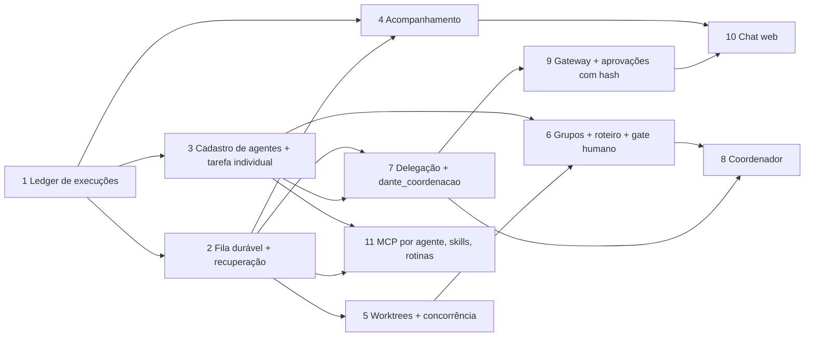

# Roadmap de implementação

Proposta para aprovação humana. **Nenhuma Issue foi criada.** Cada etapa é uma Issue → uma branch → um PR,
verificável isoladamente e útil pelo Telegram antes da seguinte. A ordem pedida foi ajustada onde as dependências
justificam: acompanhamento sobe (barato depois do ledger e necessário para depurar o resto), comunicação entra na
delegação (é o mesmo mecanismo), aprovações se dividem entre o gate de roteiro (cedo) e o gateway completo (depois),
e execução paralela se junta às worktrees (uma não existe sem a outra).

## Dependências e paralelismo

| Trilha | Pode andar em paralelo com |
| --- | --- |
| 3 (cadastro) | 2 (fila) — ambos só dependem de 1 |
| 4 (acompanhamento) | 3 e 5, depois de 2 |
| 5 (worktrees) | 3 e 4 |
| 9 (gateway) | 8 (coordenador), depois de 7 |
| 11 | qualquer etapa após 3, se priorizada |

**Primeira versão útil com um único agente: etapas 1–5** (tarefa persistente, recuperável, acompanhável, isolada
em worktree, com um agente). Grupos começam na 6.

## Etapas

### 1. Ledger de execuções — complexidade média

- **Objetivo**: execução, etapa, evento e registro de sessão persistidos; jobs e sessões espelhados.
- **Camadas/arquivos**: `Dante.Domain/Execucoes` (novo), `Dante.Application/Execucoes` (novo), `Dante.Infrastructure/{Data/Orquestracao,Modulos/Execucoes}` (DbContext, configurations, migrations do schema `orquestracao`), `Worker/Jobs/JobRegistry.cs` e `Worker/Sessions/SessionRegistry.cs` (porta opcional), comando administrativo de migration.
- **Dependências**: aprovação desta proposta (AD-66).
- **Riscos**: acoplar ao `DanteDbContext` do Brain; latência no caminho da conversa.
- **Critérios de aceite**: com banco e chave, todo job e sessão têm registro; sem banco, comportamento idêntico (suíte atual verde); transição ilegal lança; `xmin` impede sobrescrita; códigos `J…`/`S…` não reiniciam.
- **Testes**: domínio (máquina de estados por tabela); EF contra `dante-postgres-test` opt-in; composição sem banco; regressão `SessionRegistryTests`/`JobRegistryTests`.
- **Entregável**: AD-66 registrada; `/status` inalterado; histórico persiste após reinício.

### 2. Fila durável e recuperação — complexidade alta

- **Objetivo**: trabalhos com lease/heartbeat/dedupe/backoff; `/claude` e `/codex` pela fila; recuperação na inicialização, incluindo scopes órfãos.
- **Camadas**: `Application/Execucoes/Portas` (`IFilaDeTrabalho`), `Infrastructure/Fila` (SQL `SKIP LOCKED`, `LISTEN/NOTIFY`), `Infrastructure/Agentes/Contencao` (listar/parar `dante-agent-*` por nome registrado), `Worker` (`ProcessadorDaFila`, `RecuperacaoNaInicializacao`).
- **Dependências**: 1.
- **Riscos**: transação aberta durante processo; dupla execução; parada de scope errado.
- **Critérios**: dois processadores concorrentes nunca pegam o mesmo trabalho; mesma chave executa uma vez; lease perdido impede gravação; matar o Worker no meio de um job deixa `Interrompida` e nenhum processo vivo; reinício não reexecuta etapa de escrita sem confirmação.
- **Testes**: integração Postgres (concorrência real com N tarefas), relógio controlável para lease, `ContencaoNativaTests` estendido para varredura, E2E com `Dante.ProcessProbe` matando o processo.
- **Entregável**: AD-67; AD-06 marcada substituída no mesmo PR.

### 3. Cadastro de agentes e tarefa individual — complexidade média

- **Objetivo**: `Agente`/`VersaoDoAgente`; embutidos `claude`/`codex`; comandos de cadastro; `/session start <handle>`; `/tarefa <handle> [@alias] <texto>` como execução `Tarefa` (até a etapa 5, no checkout principal com reserva exclusiva de escrita por repositório).
- **Camadas**: Domain/Application `Agentes` (CRUD AD-39), `AgentContextResolver` (handle), `SessionRegistry` (versão → opções do driver), `Telegram`.
- **Dependências**: 1 (2 para `/tarefa` durável).
- **Riscos**: quebrar precedência AD-27; instruções do agente contradizendo o contrato da conversa.
- **Critérios**: handle duplicado recusado; editar cria versão; sessão/execução usa a versão congelada; desativar não afeta as ativas e recusa novas; nenhum segredo no cadastro; `/claude`/`/codex`/mensagem comum idênticos.
- **Testes**: validators, versões, tabela do resolvedor com handles, E2E com driver falso conferindo `ContextInstructions`/perfil/modelo.
- **Entregável**: AD-68.

### 4. Acompanhamento — complexidade baixa/média

- **Objetivo**: `/execucoes`, `/execucao E…` (etapas, sessão, estado, esperando o quê), cancelar/pausar/retomar com motivo, `/aguardando`; seção em `/status`; leitura na WebApi (`GET /execucoes`).
- **Dependências**: 1, 2.
- **Critérios**: toda execução ativa aparece; cancelar encerra processo (AD-17/63) e registra autor e motivo; listas mostram fatos sem conteúdo sensível.
- **Testes**: consultas por estado, autorização por dono, redaction, contrato HTTP.

### 5. Worktrees e concorrência — complexidade alta

- **Objetivo**: `ReservaDeWorktree`, `GerenciadorDeWorktreesGit` (conjunto fechado de comandos), um escritor por worktree, limites global/agente/repositório, leitura em paralelo.
- **Dependências**: 2; contenção AD-63 ativa no serviço (autorização operacional própria).
- **Riscos**: disco; arquivos ignorados necessários (`.env` locais) ausentes na worktree; interação com vinculados (AD-58).
- **Critérios**: duas escritas nunca no mesmo checkout; worktree removida só sem alterações não enviadas; limites respeitados sob carga; vinculados ganham worktree própria.
- **Testes**: integração com repositório Git temporário; concorrência da fila; recusa de comandos fora do conjunto.
- **Entregável**: AD-71.

### 6. Grupos, roteiro e gate humano — complexidade média/alta

- **Objetivo**: `GrupoDeAgentes`/`VersaoDoGrupo`, invariantes, `/grupo <nome> [@alias] <tarefa>`; roteiro implementar → revisar → corrigir → aprovação; `PedidoDeAprovacao` persistido para o gate; veredito estruturado do revisor.
- **Dependências**: 3, 5 (e 7 para `entregar_resultado`; alternativa: veredito por arquivo de resultado na worktree até a 7 existir).
- **Critérios**: mudar o grupo não muda execução iniciada; laço limitado; gate sobrevive a reinício; resultado cita quem fez cada etapa.
- **Testes**: roteiro por tabela com drivers falsos programados; reinício no meio do gate.
- **Entregável**: AD-69 (parte de roteiro).

### 7. Delegação e comunicação — complexidade alta

- **Objetivo**: `Delegacao`, `dante_coordenacao` (`consultar_agente`, `delegar_tarefa`, `estado_da_execucao`, `entregar_resultado`), retorno por novo turno, validações anti-ciclo/profundidade/dedupe/orçamento.
- **Dependências**: 2, 3.
- **Critérios**: autoconsulta, ciclo, profundidade e duplicata recusados com mensagem clara; reinício no meio preserva a delegação; resultado entra como dado não confiável com autor.
- **Testes**: casos de uso puros; MCP/IPC como `BrainMcpTests`; E2E com duas sessões simuladas; `Live*` opt-in.
- **Entregável**: AD-70.

### 8. Coordenador — complexidade média

- **Objetivo**: modo `Coordenador`; `propor_plano`, validação, aprovação do plano, despacho, consolidação com divergências.
- **Dependências**: 6, 7.
- **Critérios**: plano inválido recusado com motivo; tarefa ao grupo gera delegações rastreáveis e resposta que cita contribuições.
- **Testes**: coordenador simulado por driver falso; validação de plano por tabela.
- **Entregável**: AD-69 (parte de coordenador).

### 9. Gateway e aprovações com hash — complexidade média

- **Objetivo**: `GatewayDeFerramentas`, catálogo que nega o desconhecido, `PedidoDeAprovacao` com hash/escopo/validade/execução única; Brain e planilhas atrás do gateway sem mudar a experiência; auditoria das approvals da CLI.
- **Dependências**: 7.
- **Critérios**: aprovação não executa chamada diferente, não executa duas vezes, expira, sobrevive a reinício, reconfere concessão revogada.
- **Testes**: hash canônico, CAS de execução, revogação entre pedido e execução, regressão Brain/planilhas.
- **Entregável**: AD-72.

### 10. Chat web — complexidade alta

- **Objetivo**: autenticação da WebApi, REST de conversas/execuções/aprovações, SSE por sequência, UI mínima.
- **Dependências**: 4, 9.
- **Critérios**: o que aparece no Telegram aparece na web com o mesmo estado; reconexão sem perda de evento; WebApi nunca inicia processo.
- **Entregável**: AD-73.

### 11. MCP por agente, skills e rotinas — complexidade média

- **Objetivo**: concessões de servidores MCP externos por versão de agente com catálogo; skills só para agentes sem repositório; rotinas como execuções com autoridade "rotina".
- **Dependências**: 2, 3. Candidata a Epic própria depois da 8.

## Issues filhas sugeridas (lista enxuta)

| # | Título sugerido | Depende de |
| --- | --- | --- |
| 1 | `feat(execucoes): ledger de execuções no PostgreSQL com espelho de jobs e sessões` | aprovação da #297 |
| 2 | `feat(execucoes): fila durável com lease e recuperação após reinício` | 1 |
| 3 | `feat(agentes): cadastro versionado de agentes e tarefa individual persistente` | 1 |
| 4 | `feat(execucoes): acompanhamento e controle de execuções` | 1, 2 |
| 5 | `feat(execucoes): worktree por execução de escrita e limites de concorrência` | 2 |
| 6 | `feat(grupos): grupos versionados com roteiro determinístico e gate humano` | 3, 5 |
| 7 | `feat(delegacao): delegação rastreada e comunicação via dante_coordenacao` | 2, 3 |
| 8 | `feat(grupos): coordenador por papel com plano validado e consolidação` | 6, 7 |
| 9 | `feat(seguranca): gateway de ferramentas e aprovações vinculadas a hash` | 7 |
| 10 | `feat(webapi): chat web com eventos em tempo real sobre o ledger` | 4, 9 |
| 11 | `feat(agentes): MCP por agente, skills e rotinas` (ou Epic própria) | 2, 3 |

Criar só as Issues 1–3 após a aprovação; as demais quando a anterior estiver em review, para refinar com o que
cada entrega ensinar.
