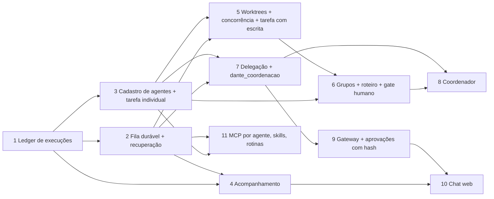

# Roadmap de implementação

Proposta para aprovação humana. **Nenhuma Issue foi criada.** Cada etapa é uma Issue → uma branch → um PR,
verificável isoladamente e útil pelo Telegram antes da seguinte. A ordem pedida foi ajustada onde as dependências
justificam: acompanhamento sobe (barato depois do ledger e necessário para depurar o resto), comunicação entra na
delegação (é o mesmo mecanismo), aprovações se dividem entre o gate de roteiro (cedo) e o gateway completo (depois),
e execução paralela se junta às worktrees (uma não existe sem a outra).

## Dependências e paralelismo

| Trilha | Pode andar em paralelo com |
| --- | --- |
| 3 (cadastro) | 2 (fila) — ambos só dependem de 1 |
| 4 (acompanhamento) | 3 e 5, depois de 2 |
| 5 (worktrees) | 4; a parte de worktree pode começar junto com a 3, mas a liberação da `/tarefa` com escrita depende dela |
| 9 (gateway) | 8 (coordenador), depois de 7 |
| 11 | qualquer etapa após 3, se priorizada |

**Primeira versão útil com um único agente: etapas 1–5** (tarefa persistente, recuperável, acompanhável, isolada
em worktree, com um agente). Tarefas individuais de **leitura** existem desde a 3; tarefas que **escrevem** em
repositório só são liberadas pela 5, junto com as worktrees. Grupos começam na 6.

**Regra transversal**: nenhuma execução nova (`Tarefa`, `Roteiro`, `Coordenada`, `Delegada`, `Rotina`) escreve no
checkout principal, em nenhuma etapa do roadmap. Antes da 5, toda execução nova é somente leitura; depois, toda
etapa de escrita exige worktree reservada. Só os fluxos legados (sessão comum, `/claude`, `/codex`, execução
`Avulsa`) continuam no checkout principal, como hoje
([PERSISTENCE_AND_EXECUTIONS](PERSISTENCE_AND_EXECUTIONS.md#worktrees-e-concorrência)).

## Etapas

### 1. Ledger de execuções — complexidade média

- **Objetivo**: execução, etapa, evento e registro de sessão persistidos; jobs e sessões espelhados.
- **Camadas/arquivos**: `Dante.Domain/Execucoes` (novo), `Dante.Application/Execucoes` (novo), `Dante.Infrastructure/{Data/Orquestracao,Modulos/Execucoes}` (DbContext, configurations, migrations do schema `orquestracao`), `Worker/Jobs/JobRegistry.cs` e `Worker/Sessions/SessionRegistry.cs` (porta opcional), comando administrativo de migration.
- **Dependências**: aprovação desta proposta (AD-66).
- **Riscos**: acoplar ao `DanteDbContext` do Brain; latência no caminho da conversa.
- **Critérios de aceite**: com banco e chave, todo job e sessão têm registro; sem banco, comportamento idêntico (suíte atual verde); transição ilegal lança; `xmin` impede sobrescrita; códigos `J…`/`S…` não reiniciam.
- **Testes**: domínio (máquina de estados por tabela); EF contra `dante-postgres-test` opt-in; composição sem banco; regressão `SessionRegistryTests`/`JobRegistryTests`.
- **Entregável**: AD-66 registrada; `/status` inalterado; histórico persiste após reinício.

### 2. Fila durável e recuperação — complexidade alta

- **Objetivo**: trabalhos com lease/heartbeat/dedupe/backoff; `/claude` e `/codex` pela fila; recuperação na inicialização, incluindo scopes órfãos.
- **Camadas**: `Application/Execucoes/Portas` (`IFilaDeTrabalho`), `Infrastructure/Fila` (SQL `SKIP LOCKED`, `LISTEN/NOTIFY`), `Infrastructure/Agentes/Contencao` (listar/parar `dante-agent-*` por nome registrado), `Worker` (`ProcessadorDaFila`, `RecuperacaoNaInicializacao`).
- **Dependências**: 1.
- **Riscos**: transação aberta durante processo; dupla execução; parada de scope errado.
- **Critérios**: dois processadores concorrentes nunca pegam o mesmo trabalho; mesma chave executa uma vez; lease perdido impede gravação; matar o Worker no meio de um job deixa `Interrompida` e nenhum processo vivo; reinício não reexecuta etapa de escrita sem confirmação.
- **Testes**: integração Postgres (concorrência real com N tarefas), relógio controlável para lease, `ContencaoNativaTests` estendido para varredura, E2E com `Dante.ProcessProbe` matando o processo.
- **Entregável**: AD-67; AD-06 marcada substituída no mesmo PR.

### 3. Cadastro de agentes e tarefa individual de leitura — complexidade média

- **Objetivo**: `Agente`/`VersaoDoAgente`; embutidos `claude`/`codex`; comandos de cadastro; `/session start <handle>`; `/tarefa <handle> [@alias] <texto>` como execução `Tarefa` **somente leitura**: perfil efetivo `plan` (AD-24), qualquer que seja o perfil padrão do agente, podendo ler o checkout principal. Tarefa com escrita fica indisponível até a etapa 5; a resposta da `/tarefa` informa que a execução é de leitura.
- **Camadas**: Domain/Application `Agentes` (CRUD AD-39), `AgentContextResolver` (handle), `SessionRegistry` (versão → opções do driver), `Telegram`.
- **Dependências**: 1 (2 para `/tarefa` durável).
- **Riscos**: quebrar precedência AD-27; instruções do agente contradizendo o contrato da conversa.
- **Critérios**: handle duplicado recusado; editar cria versão; sessão/execução usa a versão congelada; desativar não afeta as ativas e recusa novas; nenhum segredo no cadastro; `/claude`/`/codex`/mensagem comum idênticos; toda `Tarefa` roda com perfil `plan` e etapas sem `Escrita`; nenhuma etapa com `Escrita` é criada ou executada nesta entrega (o executor recusa, fail-closed).
- **Testes**: validators, versões, tabela do resolvedor com handles, E2E com driver falso conferindo `ContextInstructions`/perfil/modelo; `/tarefa` com agente de perfil padrão de escrita sai em `plan`; etapa de escrita sem worktree é recusada.
- **Entregável**: AD-68.

### 4. Acompanhamento — complexidade baixa/média

- **Objetivo**: `/execucoes`, `/execucao E…` (etapas, sessão, estado, esperando o quê), cancelar/pausar/retomar com motivo, `/aguardando`; seção em `/status`. Leitura pela WebApi fica na etapa 10, depois da autenticação.
- **Dependências**: 1, 2.
- **Critérios**: toda execução ativa aparece; cancelar encerra processo (AD-17/63) e registra autor e motivo; listas mostram fatos sem conteúdo sensível.
- **Testes**: consultas por estado, autorização por dono, redaction.
- **Implementação (#305, AD-74)**: casos de uso de consulta e cancelamento na Application, neutros de interface, com o
  Telegram como primeiro adaptador. Cancelamento durável pelo evento `CancelamentoSolicitado`, honrado sob posse por quem
  tem o trabalho. **Pausa e retomada ficaram de fora**: não há estado, checkpoint nem pedido durável que as garantam.
  O cancelamento de uma Tarefa encerra a sessão reservada pelo token do executor; a parada por scope (AD-63) segue a
  contenção já existente.

### 5. Worktrees, concorrência e tarefas com escrita — complexidade alta

- **Objetivo**: `ReservaDeWorktree`, `GerenciadorDeWorktreesGit` (conjunto fechado de comandos), um escritor por worktree, limites global/agente/repositório, leitura em paralelo; **libera a `/tarefa` com escrita** (perfil efetivo derivado da versão do agente, sempre numa worktree).
- **Dependências**: 2; contenção AD-63 ativa no serviço (autorização operacional própria).
- **Riscos**: disco; arquivos ignorados necessários (`.env` locais) ausentes na worktree; interação com vinculados (AD-58).
- **Critérios**: duas escritas nunca no mesmo checkout; nenhuma etapa de escrita roda sem reserva de worktree ativa nem com diretório de trabalho no checkout principal (o executor recusa, fail-closed); `/tarefa` com escrita cria worktree e branch próprias; worktree removida só sem alterações não enviadas; limites respeitados sob carga; vinculados ganham worktree própria.
- **Testes**: integração com repositório Git temporário; concorrência da fila; recusa de comandos fora do conjunto; etapa de escrita apontando para o checkout principal é recusada.
- **Entregável**: AD-71.
- **Implementação (#307, AD-71)**: pedido explícito `/tarefa <handle> @alias escrever <texto>`; uma worktree por
  repositório envolvido (principal e vinculados), reservadas atomicamente sob posse no PostgreSQL (trava transacional +
  índices únicos), criadas pelo `GerenciadorDeWorktreesGit` (conjunto fechado, sem `--force`, sem `prune`) e validadas
  antes da sessão. **Divergências**: a escrita só é liberada para o driver com sandbox de SO comprovado (Codex); Claude
  fica recusado. O agente não faz commit nem push (diretório Git comum somente leitura no sandbox): push/PR pelo agente
  ficou para depois, sob processo confiável e aprovação. Limites global (por host) e por repositório no banco, global
  fixado em 1 pela composição até a ativação autorizada da AD-63; limite por versão de agente segue o
  `ExecucoesSimultaneas` das sessões. Remoção só da worktree limpa e sem commits além da base; branch nunca apagada.

### 6. Grupos, roteiro e gate humano — complexidade média/alta

- **Objetivo**: `GrupoDeAgentes`/`VersaoDoGrupo`, invariantes, `/grupo <nome> [@alias] <tarefa>`; roteiro implementar → revisar → corrigir → aprovação; `PedidoDeAprovacao` persistido para o gate; veredito estruturado do revisor por `entregar_resultado`.
- **Dependências**: 3, 5. O esqueleto do `dante_coordenacao` (servidor MCP + IPC da sessão + gateway mínimo, com `entregar_resultado` e `estado_da_execucao`) nasce na primeira das etapas 6 e 7 a ser implementada; a outra o reutiliza.
- **Critérios**: mudar o grupo não muda execução iniciada; laço limitado; gate sobrevive a reinício; resultado cita quem fez cada etapa.
- **Testes**: roteiro por tabela com drivers falsos programados; reinício no meio do gate.
- **Entregável**: AD-69 (parte de roteiro).
- **Implementação (#308, AD-69)**: em três PRs. Cadastro versionado com ativação humana vinculada ao hash; gate
  durável (snapshot imutável, objetivo nunca gravado bruto, pedido de aprovação vinculado ao hash do diff, reserva
  `AguardandoDecisao` que libera o slot e mantém a worktree); executor com sessões Codex separadas, revisão em sandbox
  somente leitura e veredito pela ferramenta `entregar_resultado` do `dante_coordenacao` (fundação criada aqui:
  servidor MCP, IPC por sessão, token e escopo). **Divergências**: implementador e revisor são Codex (Claude sem
  sandbox de SO); sem push/PR pelo agente (o roteiro termina no gate e a entrega fica para o gateway #311); a etapa
  "Entregar" (`AcaoDoDante`) não existe ainda; um repositório por roteiro.

### 7. Delegação e comunicação — complexidade alta

- **Objetivo**: `Delegacao`, ferramentas `consultar_agente` e `delegar_tarefa` no `dante_coordenacao` (esqueleto da etapa 6 ou criado aqui), retorno por novo turno, validações anti-ciclo/profundidade/dedupe/orçamento.
- **Dependências**: 2, 3. Delegação `Tarefa` com escrita só depois da 5 (worktree) **e** da 9 (aprovação pelo gateway); até lá, só `Consulta` e `Tarefa` de leitura ([DELEGATION](DELEGATION.md#validações-determinísticas-no-caso-de-uso-antes-de-qualquer-processo)).
- **Critérios**: autoconsulta, ciclo, profundidade e duplicata recusados com mensagem clara; reinício no meio preserva a delegação; resultado entra como dado não confiável com autor; delegação com escrita recusada enquanto não houver worktree e aprovação pelo gateway.
- **Testes**: casos de uso puros; MCP/IPC como `BrainMcpTests`; E2E com duas sessões simuladas; `Live*` opt-in.
- **Entregável**: AD-70.
- **Implementação (#309, AD-70)**: em três PRs. O primeiro (domínio e persistência) traz a hierarquia de execuções
  (raiz, pai, profundidade, tipo `Delegada`, conferida e imutável no banco), a `Delegacao` com contratos tipados do
  catálogo fechado, as regras por interseção, as concessões `coordenacao`/`PodeConsultar`/limites com hash
  retrocompatível e a deduplicação concorrente por unidade de trabalho, sem nada exposto em tempo de execução.
  O segundo (Application, fila e executor) traz os casos de uso internos, a criação serializada por raiz, a
  subordinada na fila durável com fencing, o executor somente leitura, o resultado validado pelo contrato, a espera e
  a retomada idempotente da origem, prazos, falha, cancelamento em cascata e a recuperação após reinício. O terceiro
  expõe as ferramentas no `dante_coordenacao`.
  **Divergências**: teto global de profundidade 1 e paralelismo 1; delegação só de leitura; a mesma unidade para outro
  agente é recusada; origem só de `Tarefa` (grupos e roteiros ficam para a #310); até o PR 3, o resultado vem do bloco
  JSON da última mensagem (sem ferramenta) e `revisao.v1` é recusado até existir artefato verificável pelo executor.

### 8. Coordenador — complexidade média

- **Objetivo**: modo `Coordenador`; `propor_plano`, validação, aprovação do plano, despacho, consolidação com divergências.
- **Dependências**: 6, 7.
- **Critérios**: plano inválido recusado com motivo; tarefa ao grupo gera delegações rastreáveis e resposta que cita contribuições.
- **Testes**: coordenador simulado por driver falso; validação de plano por tabela.
- **Entregável**: AD-69 (parte de coordenador).

### 9. Gateway e aprovações com hash — complexidade média

- **Objetivo**: política de aprovação no `GatewayDeFerramentas` (o gateway mínimo já existe desde a 6/7): `PedidoDeAprovacao` com hash/escopo/validade/execução única para ações do D.A.N.T.E., `pedir_aprovacao`; Brain e planilhas atrás do gateway sem mudar a experiência; auditoria das approvals da CLI.
- **Dependências**: 7; 5 para liberar a delegação com escrita.
- **Critérios**: aprovação não executa chamada diferente, não executa duas vezes, expira, sobrevive a reinício, reconfere concessão revogada; delegação `Tarefa` com escrita passa a ser aceita só com aprovação e worktree.
- **Testes**: hash canônico, CAS de execução, revogação entre pedido e execução, regressão Brain/planilhas.
- **Entregável**: AD-72.

### 10. Chat web — complexidade alta

- **Objetivo**: autenticação da WebApi, REST de conversas/execuções/aprovações (inclui a leitura de execuções antes prevista na 4), SSE por sequência, UI mínima.
- **Dependências**: 4, 9.
- **Critérios**: o que aparece no Telegram aparece na web com o mesmo estado; reconexão sem perda de evento; WebApi nunca inicia processo.
- **Entregável**: AD-73.

### 11. MCP por agente, skills e rotinas — complexidade média

- **Objetivo**: concessões de servidores MCP externos por versão de agente com catálogo; skills só para agentes sem repositório; rotinas como execuções com autoridade "rotina".
- **Dependências**: 2, 3; 5 para rotinas que escrevem em repositório. Candidata a Epic própria depois da 8.

## Issues filhas sugeridas (lista enxuta)

| # | Título sugerido | Depende de |
| --- | --- | --- |
| 1 | `feat(execucoes): ledger de execuções no PostgreSQL com espelho de jobs e sessões` | aprovação da #297 |
| 2 | `feat(execucoes): fila durável com lease e recuperação após reinício` | 1 |
| 3 | `feat(agentes): cadastro versionado de agentes e tarefa individual de leitura` | 1 |
| 4 | `feat(execucoes): acompanhamento e controle de execuções` | 1, 2 |
| 5 | `feat(execucoes): worktree por execução de escrita, limites de concorrência e tarefa com escrita` | 2, 3 |
| 6 | `feat(grupos): grupos versionados com roteiro determinístico e gate humano` | 3, 5 |
| 7 | `feat(delegacao): delegação rastreada e comunicação via dante_coordenacao` | 2, 3 |
| 8 | `feat(grupos): coordenador por papel com plano validado e consolidação` | 6, 7 |
| 9 | `feat(seguranca): gateway de ferramentas e aprovações vinculadas a hash` | 7 |
| 10 | `feat(webapi): chat web com eventos em tempo real sobre o ledger` | 4, 9 |
| 11 | `feat(agentes): MCP por agente, skills e rotinas` (ou Epic própria) | 2, 3 |

Criar só as Issues 1–3 após a aprovação; as demais quando a anterior estiver em review, para refinar com o que
cada entrega ensinar.
