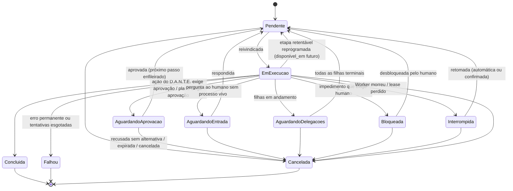

# Persistência e execuções

## Decisão recomendada

**PostgreSQL é a fonte de verdade do trabalho; a memória continua sendo o runtime.** Arquitetura híbrida:

| Persistido (PostgreSQL) | Em memória (Worker) |
| --- | --- |
| Agentes, grupos e versões | Processos vivos e drivers (`SessionRegistry`, `InteractiveAgentProcess`) |
| Execuções, etapas, dependências, delegações | Fila de turnos da sessão (AD-16) e steer |
| Pedidos de aprovação do D.A.N.T.E. e auditoria das approvals da CLI | Requests pendentes da CLI (vivem com o processo, AD-22) |
| Registros de sessão (metadados, motivo do fim) | Deltas de streaming e buffers de entrega (AD-21) |
| Eventos-chave da execução (sem deltas) | Tokens de cancelamento, sinais para acordar a fila |
| Fila durável, leases, reservas de worktree | Cache do catálogo de modelos (AD-25) |

Princípio: **nada que precise sobreviver a um reinício fica só em memória; nada que só faz sentido com o processo
vivo é persistido como se fosse retomável.**

## Banco, schema e DbContext

- mesmo PostgreSQL e mesma `ConnectionStrings:Dante` do Brain (AD-34/43), **schema próprio `orquestracao`**,
  tabelas `snake_case` PT-BR, histórico de migrations próprio em `orquestracao.__historico_de_migrations`;
- **DbContext próprio** (`OrquestracaoDbContext`) na Infrastructure: o `DanteDbContext` exige
  `AutorizacaoDoBrain`, aplica `FiltrosDoBrain` e `ValidacaoDeEscritaDoBrain`, que não fazem sentido para execuções.
  Reutilizam-se `EntidadeConfiguration` (Guid do domínio + `xmin` como `Versao`), `Repository<T>`, o padrão de
  `UnitOfWork` e o comando administrativo `--brain migrate` estendido (ou `--banco migrate`), sem migração
  automática no startup (AD-53). Aplicar a migration no banco canônico do homelab é passo operacional com
  autorização própria, como nas migrations do Brain;
- **sem banco configurado**, o Worker continua exatamente como hoje (jobs e sessões em memória) e os comandos
  multiagente respondem "indisponível sem banco". Mesma postura opcional do Brain (AD-54). Ver ponto de aprovação
  no [README](README.md#pontos-que-precisam-de-aprovação).

## Tabelas

| Tabela | Chaves e índices relevantes |
| --- | --- |
| `agentes` | `handle` único |
| `versoes_de_agente` | (`id_agente`, `numero`) único; imutável |
| `grupos_de_agentes`, `versoes_de_grupo`, `participantes_da_versao_de_grupo` | (`id_grupo`, `numero`) único |
| `sessoes_de_agente` | `numero` (sequência → `S…`), índice por `estado` |
| `execucoes` | `numero` (sequência → `E…`), índices por `estado`, `id_execucao_raiz`, `id_execucao_pai` |
| `etapas_da_execucao` | (`id_execucao`, `numero`) único; `chave_de_idempotencia` única |
| `dependencias_de_etapa` | (`id_etapa`, `id_etapa_requerida`) |
| `delegacoes` | `chave_de_deduplicacao` única entre as não terminais (índice parcial) |
| `pedidos_de_aprovacao` | `hash_dos_parametros`, `expira_em`, `executada_em` |
| `chamadas_de_ferramenta` | por execução/etapa |
| `eventos_da_execucao` | `sequencia bigint` global crescente; (`id_execucao`, `sequencia`) |
| `trabalhos_da_fila` | `chave_de_deduplicacao` única; índice parcial `(disponivel_em) WHERE estado = 'pendente'` |
| `reservas_de_worktree` | (`alias`, `caminho`) único entre ativas; índice parcial "um escritor por worktree" |

## Estados

### Execução



| Classe pedida | Estado(s) |
| --- | --- |
| Trabalho pendente | `Pendente` |
| Em execução | `EmExecucao` |
| Aguardando aprovação | `AguardandoAprovacao` (e `AguardandoEntrada` para perguntas) |
| Bloqueado | `Bloqueada` (impedimento humano) e `AguardandoDelegacoes` (dependência interna) |
| Concluído | `Concluida` |
| Com falha | `Falhou` |
| Cancelado | `Cancelada` |
| Pode ser retomado | `Interrompida` e `Bloqueada`. `Falhou` é terminal: erro retentável de etapa não chega a falhar a execução (ela volta a `Pendente` com espera); refazer uma execução falha é criar outra que referencia a anterior |

Transições são métodos do domínio (`Execucao.Iniciar`, `AguardarAprovacao`, `Concluir`…) que recusam origem
inválida, e cada gravação usa `xmin` (AD-43): duas gravações concorrentes resultam em
`ConflitoDeConcorrenciaException`, nunca em estado sobrescrito.

### Etapa

`Pendente → Pronta (dependências satisfeitas) → EmExecucao → Concluida | Falhou | Cancelada | Interrompida`, mais
`AguardandoAprovacao`/`AguardandoEntrada` e `Ignorada` (ramo não necessário). Cada etapa declara:

| Atributo | Uso |
| --- | --- |
| `Tipo` | `TurnoDeAgente` (numa sessão), `ProcessoAvulso` (one-shot), `AprovacaoHumana`, `AcaoDoDante` (via gateway), `Consolidacao` |
| `Escrita` | se altera repositório; exige reserva de worktree |
| `PoliticaDeRetomada` | `Automatica` (leitura, idempotente), `ComConfirmacao` (escrita), `Nunca` (ação externa com resultado incerto) |
| `ChaveDeIdempotencia` | `execucao:numero:tentativa`; impede dupla conclusão |
| `IdSessao`, `IdTurno` | onde rodou |
| `Resultado` | texto final redigido, artefatos, veredito estruturado, uso de tokens |

## Ciclo de vida de uma execução

```mermaid
sequenceDiagram
  participant U as Telegram / WebApi
  participant A as Application (CasosDeUso de Execucao)
  participant DB as PostgreSQL
  participant F as ProcessadorDaFila (Worker)
  participant X as ExecutorDeEtapa
  participant S as SessionRegistry / Runner
  U->>A: IniciarExecucao(alvo, objetivo, contexto)
  A->>DB: 1 transação: execucao(Pendente) + etapas + evento Criada + trabalho(AvancarExecucao, dedupe)
  A-->>U: "E123 criada"
  A-->>F: sinal em memória (e NOTIFY)
  F->>DB: reivindica trabalho (SKIP LOCKED, lease 60 s)
  F->>X: próxima etapa pronta
  X->>DB: etapa EmExecucao (CAS) + reserva de worktree se Escrita + evento
  X->>S: inicia/usa sessão ou processo; heartbeat renova lease
  S-->>X: eventos (AgentEvent) → projetor grava eventos-chave
  S-->>X: TurnCompleted / processo terminou
  X->>DB: 1 transação: resultado da etapa + transição + próximo trabalho + evento + fim do trabalho atual
  Note over X,DB: o resultado é gravado ANTES de avançar; a próxima etapa só existe se esta transação confirmou
  F->>DB: ... até Concluida/Falhou/AguardandoAprovacao
  DB-->>U: eventos (Telegram via sink, WebApi via SSE)
```

## Recuperação após reinício ou reboot

Executada uma vez pelo hosted service de recuperação, **antes** de o processador da fila começar:

1. **Parar órfãos**: listar unidades `dante-agent-*.scope` do usuário e parar só as que o ledger registra como de
   sessão não terminal de boot anterior (o registro da sessão guarda o nome da unidade). Unidade desconhecida do
   ledger é relatada, não parada. Hoje isso não existe (lacuna do [INVENTARIO](INVENTARIO.md)).
   Em modo compatibilidade (sem scope), matar PIDs registrados cujo horário de início confere (mesma regra da
   AD-17);
2. **Sessões**: toda `SessaoDeAgente` não terminal de boot anterior → `Interrompida` ("reinício do Worker");
3. **Etapas `EmExecucao` de boot anterior** → `Interrompida`; a execução → `Interrompida`; evento registrado;
4. **Trabalhos reivindicados de boot anterior** → devolvidos à fila (o Worker é instância única no host — systemd —
   então lease de boot anterior está morto sem esperar expirar; ver [DURABLE_QUEUE](DURABLE_QUEUE.md));
5. **Retomada por política**: etapa `Automatica` → execução volta a `Pendente`; `ComConfirmacao` → o usuário recebe
   "E123 foi interrompida na etapa 2 (escrita em `@dante`); estado da worktree: … `/execucao retomar E123`";
   `Nunca` → `Bloqueada` com "resultado incerto, confira antes de continuar";
6. **Aprovações persistidas** continuam válidas até `expira_em`; trabalhos de expiração voltam a disparar;
7. **Reservas de worktree** de execuções terminais → liberadas; de interrompidas → mantidas (a retomada usa a mesma).

O que **não** é retomado: o processo da CLI e a conversa upstream. Retomar uma etapa de agente é iniciar uma sessão
nova da mesma versão do agente, no mesmo contexto/worktree, com um prólogo gerado do ledger: objetivo, etapas
concluídas e seus resultados, motivo da interrupção e o estado do checkout lido por `ILeitorDeCheckouts`.

## O que acontece quando o processo morre durante a chamada à CLI

| Caso | Efeito | Tratamento |
| --- | --- | --- |
| A CLI morre, Worker vivo | `ReadEventsAsync` termina com erro; sessão `Failed` (AD-20) | Etapa `Falhou` com erro `Retentavel` conforme a causa (limite de plano, processo morto); política decide nova tentativa (máx. configurável) |
| Worker morre, CLI viva no scope | Scope sobrevive até a varredura | Recuperação para o scope; etapa `Interrompida` |
| Worker e CLI morrem (reboot) | Nada vivo | Etapa `Interrompida` |
| Efeitos parciais em disco | Arquivos alterados na worktree, talvez commits | Nunca descartados; relatados pelo `ILeitorDeCheckouts`; a retomada continua sobre eles |
| Efeitos externos parciais (push, PR, comentário) | Feitos pela CLI, invisíveis ao D.A.N.T.E. | Retomada `ComConfirmacao` + prólogo que manda o agente verificar antes de repetir; o D.A.N.T.E. não presume |

## Evitar repetir ação concluída

- **Etapa**: concluir é `UPDATE … WHERE id = @id AND estado = 'em_execucao' AND tentativa = @tentativa`; zero linhas
  → descartar o resultado (outra tentativa venceu). A próxima etapa só é criada na mesma transação;
- **Trabalho da fila**: `chave_de_deduplicacao` única; enfileirar duas vezes a mesma chave é no-op;
- **Ação do D.A.N.T.E. aprovada**: `executada_em` marcado por CAS **antes** de executar; se o processo cair entre a
  marcação e o registro do resultado, o resultado fica `Incerto` e nunca é reexecutado automaticamente (mesma
  postura do upload incerto da AD-55);
- **Ação feita pela CLI**: fora do controle do D.A.N.T.E.; mitigada por worktree isolada, perfil e prólogo de retomada.

## Worktrees e concorrência

| Regra | Implementação |
| --- | --- |
| Uma execução por tarefa | A execução é a tarefa; etapas são partes dela |
| Uma worktree por execução que escreve | `ReservaDeWorktree` criada na primeira etapa `Escrita`; `~/.dante/worktrees/<alias>/E<numero>`, branch `dante/<handle>/e<numero>-<slug>` a partir da base escolhida |
| Isolamento por repositório | Worktree derivada do repositório cadastrado; vinculados (AD-58) ganham worktree própria na mesma execução, congelados com o principal |
| Um escritor por worktree | Índice parcial único `(id_worktree) WHERE escritor_ativo`; etapas de escrita da mesma execução são serializadas pelo plano (dependências) e pelo índice |
| Leitura em paralelo | Etapas sem `Escrita` rodam em perfil `plan` (read-only), no checkout principal ou na worktree, sem reserva de escrita |
| Concorrência entre tarefas independentes | Execuções diferentes têm worktrees diferentes; limite global de processos (padrão 3), por versão de agente (padrão 1–2) e por repositório (padrão 2 worktrees de escrita) |
| Fluxos legados (sessão comum, `/claude`, `/codex`, execução `Avulsa`) | Continuam no checkout principal, como hoje; **não** reservam worktree. Execuções novas (`Tarefa`, `Roteiro`, `Coordenada`, `Delegada`, `Rotina`) nunca escrevem no checkout principal, então não colidem com eles |
| Checkout principal protegido (fail-closed) | O `ExecutorDeEtapa` recusa etapa `Escrita` sem `ReservaDeWorktree` ativa da própria execução ou com diretório de trabalho no checkout principal. Antes da etapa 5 do roadmap não existe reserva, então toda etapa de escrita de execução nova é recusada e a `/tarefa` roda só em leitura ([roadmap](IMPLEMENTATION_ROADMAP.md#3-cadastro-de-agentes-e-tarefa-individual-de-leitura--complexidade-média)) |
| Merge | Nunca pelo D.A.N.T.E. (contrato e AD-58). O agente faz push e PR da branch; o merge é humano |
| Conflitos | Detectados no PR (GitHub) ou por `ILeitorDeCheckouts` (base divergente); viram etapa de correção ou `Bloqueada` |
| Limpeza | Worktree removida (`git worktree remove`) quando a execução termina **e** a branch foi enviada ou o usuário descartou; nunca com alterações não enviadas sem confirmação |

Comandos git que o D.A.N.T.E. passa a executar — conjunto fechado, `ArgumentList`, sem shell, mesmo padrão do
`LeitorDeCheckoutsGit`: `worktree add`, `worktree remove`, `worktree prune`, `worktree list`. Nunca `--force`
(o Git recusa remover worktree com alterações, e essa recusa é a proteção). Nada de `push`, `merge`, `reset`,
`clean` ou `checkout` no checkout principal. Isso complementa a AD-58 e exige a AD-71 proposta.

### Implementação (#307, AD-71)

Diferenças em relação à tabela acima: a etapa de escrita nasce com a `/tarefa … escrever`, e a reserva é feita pelo
executor, sob posse, antes da sessão (não na transição `EmExecucao`), uma por repositório envolvido; todas ou nenhuma.
Índices únicos parciais entre as ativas por caminho, por repositório + branch e por execução + alias (em vez de
"escritor ativo"). Limites global por host e por repositório (o global fica em 1 até a ativação autorizada da AD-63).
A sessão de escrita só existe com sandbox de SO confirmado pela CLI (Codex `workspace-write`); Claude não escreve. O
diretório Git comum fica somente leitura para o agente: sem commit nem push nesta entrega, e a limpeza preserva a
worktree com alterações em vez de exigir branch enviada. Reservas de execuções interrompidas ficam mantidas, mas não
contam na capacidade.

### Pipeline de desenvolvimento como etapas persistentes

```text
E123 (Roteiro "implementar-e-revisar", grupo engenharia v3, @dante)
 ├─ 1 Implementar      claude-dev   Escrita   ComConfirmacao   worktree W  → push + PR (agente)
 ├─ 2 Revisar          codex-rev    Leitura   Automatica       sobre W     → veredito {aprovado|ajustes, itens}
 ├─ 3 Corrigir         claude-dev   Escrita   ComConfirmacao   W           (só se 2 pediu ajustes; volta a 2; máx. 2 rodadas)
 ├─ 4 Aprovacao        humano       —         —                            → aprovado | recusado com motivo
 └─ 5 Entregar         —            AcaoDoDante                             → registra PR pronto para merge humano
```

O veredito do revisor é saída estruturada (ferramenta `entregar_resultado` do `dante_coordenacao`, com schema),
não texto interpretado. O laço 2↔3 é regra do roteiro, com limite, não decisão livre de um modelo.
