# Segurança, gateway de ferramentas e aprovações

## Limite real do que o D.A.N.T.E. controla

Há dois tipos de ferramenta, e a proposta não finge que são iguais:

| Ferramenta | Quem executa | Controle do D.A.N.T.E. hoje | Proposta |
| --- | --- | --- | --- |
| **Nativas da CLI** (Bash, Edit, Write, WebFetch, comandos do Codex) | A própria CLI, dentro do processo contido | Perfil/modo (AD-18/19/24), approvals correlacionadas (AD-22), ambiente filtrado (AD-09/10), contenção cgroup (AD-63), diretórios permitidos (AD-58) | **Mantido.** O gateway não as executa nem as intercepta; registra os pedidos de approval e os eventos `ToolStarted/Completed` no ledger para auditoria |
| **Do D.A.N.T.E.** (`dante_brain`, `dante_planilhas`, `dante_coordenacao`, futuras ações como publicar artefato) | O Worker, via MCP stdio + IPC por sessão | Autorização própria em cada servidor (AD-55/56) | **Gateway único** na Application |

Interceptar ferramentas nativas exigiria trocar o modelo de execução das CLIs (o concorrente faz isso com runner e
`--tools` restrito); fica fora, e a fronteira é a sandbox/contenção existente.

## Gateway de ferramentas do D.A.N.T.E.

```mermaid
flowchart LR
  CLI[CLI da sessão] -- MCP stdio --> SRV[servidor dante_*<br/>processo filho]
  SRV -- named pipe da sessão --> W[Worker: adapter IPC]
  W --> GW[GatewayDeFerramentas<br/>Application]
  GW --> ID[1 identificar: sessão → etapa → execução → versão do agente → autoridade]
  ID --> CAT[2 catálogo: ferramenta conhecida? nega o desconhecido]
  CAT --> PERM[3 concessão da versão do agente + papel + tipo de execução]
  PERM --> VAL[4 validar parâmetros por schema]
  VAL --> POL[5 política: livre / aprovação / proibida]
  POL -->|aprovação| PA[(PedidoDeAprovacao<br/>hash, escopo, validade)]
  POL -->|livre| EXE[6 executar: AppService da capacidade]
  PA -->|aprovado, hash confere, execução única| EXE
  EXE --> REG[(ChamadaDeFerramenta + evento)]
```



```csharp
public interface IGatewayDeFerramentas
{
    Task<ResultadoDaChamada> ChamarAsync(ChamadaSolicitada chamada, CancellationToken cancellationToken);
}

public sealed record ChamadaSolicitada(
    Guid IdSessao,                 // vem do canal IPC exclusivo, nunca de argumento
    string Ferramenta,             // "dante_coordenacao.delegar_tarefa"
    JsonElement Parametros);

public sealed record DefinicaoDeFerramenta(
    string Nome,
    JsonSchemaRef Schema,
    ClasseDeRisco Risco,           // Leitura, EscritaInterna, EfeitoExterno
    PoliticaDeAprovacao Politica); // Nunca, ConformeModo, Sempre

public abstract record ResultadoDaChamada
{
    public sealed record Executada(JsonElement Saida) : ResultadoDaChamada;
    public sealed record AguardandoAprovacao(Guid IdPedido, string Resumo) : ResultadoDaChamada;
    public sealed record Recusada(string Motivo) : ResultadoDaChamada;        // texto fixo, sem dados internos
}
```

Regras:

- **identidade nunca do prompt**: a sessão é identificada pelo canal IPC exclusivo (AD-56); dela vêm etapa,
  execução, versão do agente e autoridade;
- **catálogo nega o desconhecido**: ferramenta fora do catálogo do D.A.N.T.E. não é exposta nem executada;
- **concessão lida a cada chamada** do banco (versão congelada na execução), não do texto do prompt;
- **entrega em duas partes**: o gateway mínimo (passos 1–4, 6 e registro) nasce com o `dante_coordenacao`; a
  política de aprovação com hash (passo 5) e a migração de Brain e planilhas entram na etapa 9 do
  [roadmap](IMPLEMENTATION_ROADMAP.md#9-gateway-e-aprovações-com-hash--complexidade-média);
- **planilhas e Brain migram para trás do gateway sem mudar comportamento**: hoje suas escritas usam a aprovação
  da CLI (AD-55) ou a confirmação no Telegram (AD-56); a migração mantém essas experiências e acrescenta o registro.

## Aprovações

Dois tipos, que continuam distintos:

| | Approval da CLI (AD-22) | Aprovação do D.A.N.T.E. (nova) |
| --- | --- | --- |
| Origem | `can_use_tool` / request do app-server | Gateway, roteiro (gate humano), plano do coordenador |
| Vida | Enquanto o processo e o turno existirem; 5 min | Persistida; sobrevive a reinício; validade configurável (padrão 24 h; gate de roteiro sem expiração automática) |
| Estado durante a espera | Processo vivo esperando | Execução `AguardandoAprovacao`, sem processo |
| Persistência | Auditoria (pedido, decisão, quem, quando) | Fonte de verdade |
| Apresentação | Botões no Telegram (AD-30/#104) | Mesmos botões e mesmo formato, com `A…` em vez de `R…` |

### `PedidoDeAprovacao`

| Campo | Regra |
| --- | --- |
| `IdExecucao`, `IdEtapa`, `IdVersaoDoAgente` | vínculo obrigatório |
| `Ferramenta` / `Acao` | nome do catálogo |
| `Parametros` | JSON canônico (chaves ordenadas, sem espaços), redigido para exibição |
| `HashDosParametros` | SHA-256 de `ferramenta + parâmetros canônicos + id da execução` |
| `Escopo` | `UmaVez` (padrão) ou `EstaExecucao` para a mesma ferramenta com o mesmo alvo normalizado; **nunca** global ou permanente nesta fase |
| `ExpiraEm` | obrigatório |
| `Decisao`, `DecididoPor`, `DecididoEm`, `Motivo` | só a pessoa da raiz (allowlist, AD-05) |
| `ExecutadaEm`, `ResultadoDaExecucao` | CAS: só uma execução; `Incerto` se o processo caiu no meio |

Execução de uma ação aprovada:

1. recalcula o hash da chamada pendente guardada; diferente → recusa (uma aprovação nunca autoriza outra chamada);
2. reconfere concessão e estado do agente (pode ter sido desativado entre o pedido e a decisão);
3. `UPDATE … SET executada_em = now() WHERE id = @id AND executada_em IS NULL AND decisao = 'aprovada' AND expira_em > now()`;
   zero linhas → não executa;
4. executa exatamente os parâmetros guardados (não os reenviados pelo agente);
5. grava resultado e enfileira o avanço da execução na mesma transação.

Recusa vira resultado da ferramenta com o motivo; o agente continua o turno ciente da recusa. Recusa com motivo
pode virar **candidato** no Brain pela captura existente (com confirmação), nunca conhecimento automático.

## Least privilege por camada

```text
pessoa (allowlist, autoridade da raiz)
  ∩ versão do agente (PerfilMaximo, PodeEscrever, Concessoes, repositórios)
  ∩ versão do grupo (papel, PodeEscrever do participante, repositórios do grupo)
  ∩ tipo de execução (Delegada/Rotina mais restritas que Tarefa)
  ∩ contexto (AD-08/09/10/58: só os checkouts e o ambiente do contexto)
= o que a sessão recebe ao iniciar (perfil, diretórios, servidores MCP, ambiente)
```

Nada disso é negociado pelo modelo durante a execução; mudança exige nova versão e nova execução.

## Proteções que permanecem

- sem shell arbitrário; `ArgumentList`; prompt como dado (AD-02/03);
- `full` inexistente (AD-22/24);
- General Mode isolado (AD-09); segredos por binding, nunca no catálogo, no prompt, no ledger ou no Telegram (AD-10);
- redaction de saída e omissão com segredos vinculados (AD-21) — aplicadas também ao conteúdo que o ledger grava;
- contenção estrita por sessão (AD-63) — **pré-requisito** para execução paralela: com vários processos
  simultâneos, sobrevivente órfão deixa de ser hipótese rara;
- MCP sem credenciais na linha de comando; IPC same-user exclusivo da sessão (AD-56).

## Auditoria

Toda ação relevante vira `EventoDaExecucao` com autor (versão do agente ou pessoa), execução, etapa, ferramenta,
resultado e motivo, sem conteúdo sensível. Exportação segue o padrão da auditoria do Brain (#149).

## Riscos abertos

| Risco | Mitigação proposta |
| --- | --- |
| Approval da CLI expira em 5 min numa execução longa sem o humano por perto | Execuções de roteiro rodam em perfil que minimiza approvals da CLI (`auto` com `auto_review` no Codex, AD-19) e concentram os portões em aprovações do D.A.N.T.E., que não expiram com o processo |
| Agente faz push/PR/comentário por conta própria (efeito externo invisível) | Worktree e branch com prefixo por agente; `ContratoMultirrepositorio` estendido; identidade Git por agente (`GIT_CONFIG_GLOBAL`) numa etapa posterior; merge sempre humano |
| Resultado de outro agente com instrução maliciosa | Delimitação como dado não confiável + concessões fixas: mesmo que o modelo obedeça, não ganha ferramenta nem diretório |
| Processo malicioso do mesmo usuário | Fora do modelo de ameaça (AD-56/63) |
