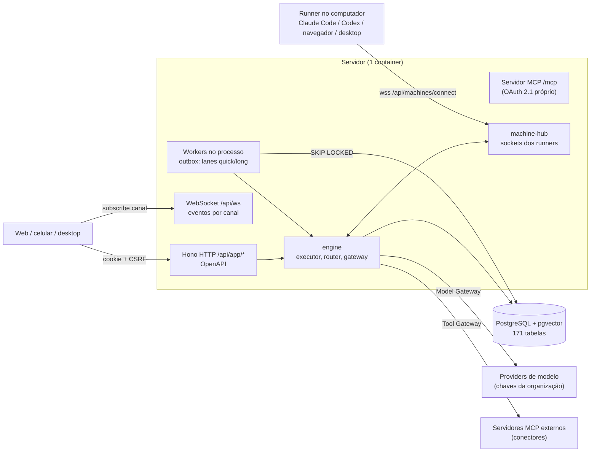
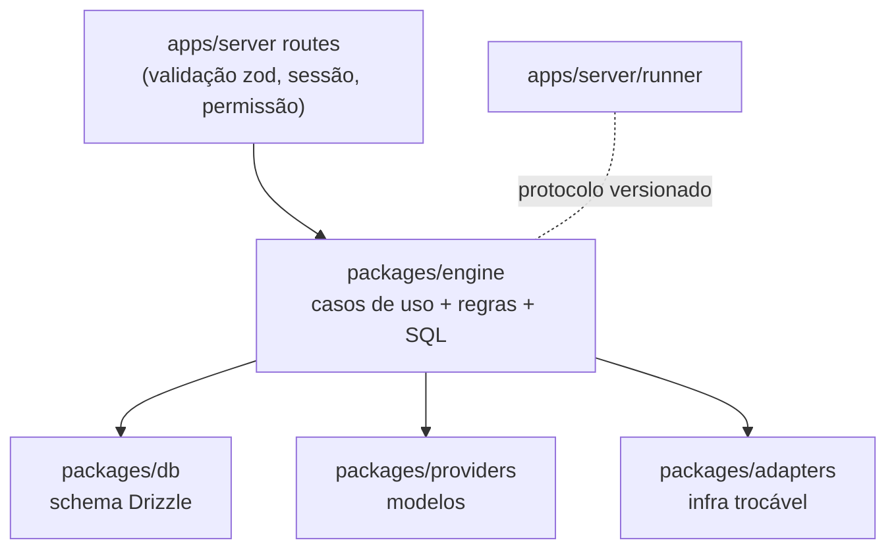

# Arquitetura geral do agentes.chat

## Stack e organização

| Camada | Tecnologia | Onde |
| --- | --- | --- |
| Servidor HTTP + WebSocket | Bun, Hono, `@hono/zod-openapi`, WebSocket nativo do Bun | `apps/server/src/{app,start}.ts`, `realtime/ws.ts` **[C]** |
| Domínio/aplicação ("engine") | TypeScript puro, funções por módulo | `packages/engine/src` (326 módulos) **[C]** |
| Persistência | PostgreSQL 18 + pgvector, Drizzle ORM, 279 migrations | `packages/db/src/schema/*`, `packages/db/migrations` **[C]** |
| Providers de modelo | adaptadores neutros (Anthropic, OpenAI, Gemini, compatíveis, OpenRouter, `custom`) | `packages/providers/src` **[C]** |
| Adaptadores de infra | busca, pub/sub, presença, rate limit, e-mail, push, armazenamento, cofre | `packages/adapters/src` **[C]** |
| Web | Vite, React, TanStack | `apps/web` **[C]** |
| Cliente compartilhado | lógica de apresentação e realtime usada por web e celular | `packages/client` **[C]** |
| Celular / desktop | Expo / Tauri | `apps/mobile`, `apps/desktop` **[C]** |
| Runner (computador do agente) | Bun, processo no host do usuário, conecta por WebSocket de saída | `apps/server/runner/*` **[C]** |
| Autenticação | Better Auth (cookie + CSRF por origem) | `apps/server/src/auth.ts` **[C]** |

Regras inegociáveis declaradas **[D]** (`CLAUDE.md` do repositório deles): Postgres é a única dependência
obrigatória; jobs são um outbox no Postgres com workers no próprio processo; toda tabela de tenant tem `org_id`;
chaves nunca vão ao cliente; toda chamada de modelo passa pelo Model Gateway, que confere orçamento antes e registra
custo depois; migrations commitadas são imutáveis; decisão arquitetural nova exige ADR.

## Processos

- Um processo Bun serve web, API, WebSocket e roda os workers (`SERVER_ROLE=all`); pode ser dividido em papéis
  (ADR 0163) **[C]** `apps/server/src/start.ts`.
- O runner é **outbound**: o computador do agente abre `wss://…/api/machines/connect` e o servidor manda
  operações por esse canal. Não há porta aberta no computador **[C]** `apps/server/runner/connection.ts`.
- Escala: vários processos são seguros porque o outbox usa lease + `FOR UPDATE SKIP LOCKED`, o pub/sub entre
  réplicas usa `NOTIFY` e RPC entre réplicas para computadores usa `machine_rpc` **[C][D]** ADR 0005/0010/0163.

## Persistência e tempo real

- **Outbox = fila de jobs.** Linhas gravadas na mesma transação da mudança que as causa (`enqueue(tx, …)`);
  lease de 2 min renovado; retry com backoff 5 s → 3 h; `dedupe_key` única; jobs com conteúdo apagado após 30 dias
  **[C]** `packages/engine/src/outbox.ts`, ADR 0005. Desde a ADR 0163 os workspaces se revezam (round robin por
  `org_id`) e há duas filas, rápida e longa **[D]**.
- **Mensagens particionadas** por tempo (migration 0000 editada à mão) **[D]** ADR 0009.
- **Tempo real**: `GET /api/ws?orgId=`; o cliente assina canais (checagem de acesso igual à HTTP, até 200
  assinaturas, rate limit); eventos `message.created`, `agent.run`, `agent.typing`, `agent.tool`,
  `approval.created/decided`, `machine.task`… **[C][D]** `apps/server/src/realtime/ws.ts`,
  `packages/engine/src/events.ts`, ADR 0010. A resposta do agente não é transmitida token a token desde
  2026-11-10: aparece inteira no `message.created`; durante o trabalho só a linha "pensando / usando ferramenta X"
  **[D]** ADR 0010 (emenda).
- **Busca** híbrida no Postgres (tsvector `simple` + vetores opcionais, RRF) **[D]** ADR 0017.

## Camadas reais (inferência a partir do código) [I]

Não há separação Domain/Application/Infrastructure como no D.A.N.T.E. (AD-35): o `engine` mistura regra e SQL
(Drizzle) por módulo funcional. O desacoplamento está nos **adaptadores** (`packages/adapters`) e nos **providers**,
trocados por variável de ambiente, e no **protocolo do runner**, versionado por número (protocolos 8 a 49 citados
nas ADRs).

## Decisões arquiteturais mais relevantes para nós

| ADR | Problema | Decisão | Interesse para o D.A.N.T.E. |
| --- | --- | --- | --- |
| 0005 | jobs sem Redis | outbox no Postgres, workers no processo, idempotência por `dedupe_key` e CAS de estado | alto: AD-06 mantém jobs em memória |
| 0008 | executar agentes de forma retomável | `agent_runs` como máquina de estados CAS; passos; transcript | alto |
| 0012 | duas runs estouram o orçamento | reserva com `SELECT … FOR UPDATE` antes da chamada | médio (CLIs por assinatura) |
| 0013/0074 | quem responde sem menção | candidatos por código, estratégia pontua, política decide; cadeia Jev → modelo pequeno → plano do autor → regras | alto, com cuidado |
| 0015 | ferramentas e aprovações | Tool Gateway único; escopos no banco; aprovação por hash; execução única | alto |
| 0029/0044 | trabalho longo de código | "missão": plano vivo, revisões em vez de portões, **um worktree por missão**, itens que escrevem em sequência | alto |
| 0032 | três caminhos de execução divergindo | um motor, cérebros trocáveis, eventos neutros | já temos (AD-15/16) |
| 0034/0095 | agentes pedem trabalho uns aos outros | consultas rastreadas, retorno único, consolidação | alto |
| 0053 | rotinas agindo com a autoridade do criador | autoridade explícita por run (pessoa, rotina, ninguém) e política por tipo de run | alto |
| 0083/0137 | organizar e coordenar o time | grupos só visuais; coordenador substituído por um agente embutido com cartões de ação | médio |
| 0089/0097/0131 | agentes que param cedo ou não param | "trechos" de trabalho autônomo com limites, controlador único de fim de turno, freios | alto (limites) |
| 0121 | run longa trava a conversa | a mesma run sai da conversa e vira trabalho em segundo plano | médio |
| 0128 | ver e parar tudo | Task Manager com motivo de parada informado ao agente | alto |
| 0163 | escala de jobs | revezamento por workspace, nenhuma transação aberta durante espera de modelo | médio |
