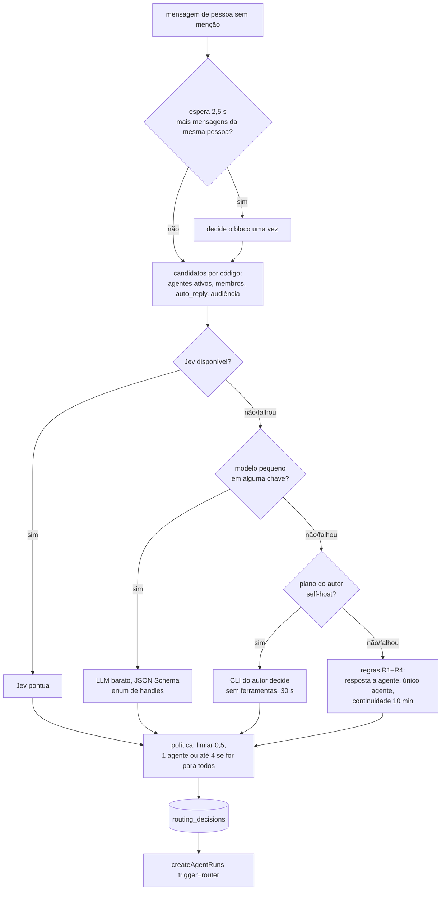
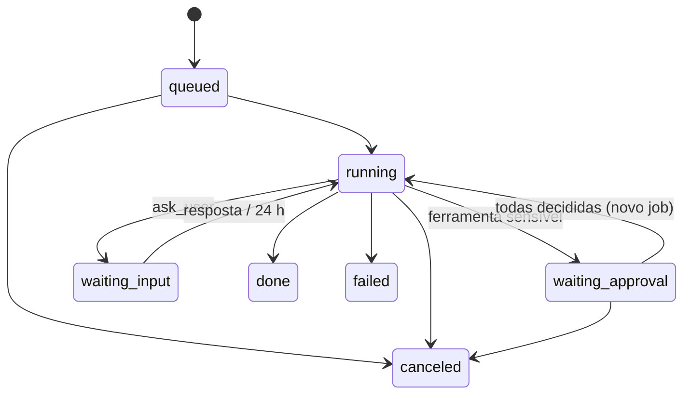

# Fluxos ponta a ponta

Caminho: interface → API → serviço → domínio → persistência → execução → eventos → resposta.

## 1. Mensagem com menção explícita

```mermaid
sequenceDiagram
  participant P as Pessoa (web)
  participant API as POST /api/app/.../channels/{id}/messages
  participant M as messages.ts insertMessageWithRuns
  participant DB as Postgres
  participant OB as outbox worker
  participant EX as executor.ts
  participant B as Cérebro (modelo ou CLI)
  participant WS as WebSocket
  P->>API: body "@dev qual a estrutura?"
  API->>M: postPersonMessage
  M->>DB: INSERT messages + agent_runs(queued) + outbox(agent_run.execute) — 1 transação
  M-->>WS: message.created
  OB->>DB: claim FOR UPDATE SKIP LOCKED (lease)
  OB->>EX: executeRun
  EX->>DB: queued→running (CAS) + passo context
  EX->>B: prefixo estável + "# This turn" + ferramentas
  B-->>EX: texto / tool_call
  EX->>DB: passos model_call, tool_call, tool_result; transcript
  EX->>DB: mensagem do agente + running→done (1 transação)
  EX-->>WS: agent.run, message.created
```

- Menções resolvidas contra **membros do canal** que são agentes ativos; a run é única por
  `(trigger_message_id, agent_id)` **[C]** ADR 0008, `dispatch.ts`.
- Várias menções numa mensagem: um juiz decide quem é destinatário e quem é só citado; sem juiz, todos agem
  (fail-open) **[D]** ADR 0034 adendo §1. **[O]** "`@dev DELEGUE @revisor`" criou duas runs; `routing_decisions`
  registrou `addressees-llm` e `mention-judge`.
- **[O]** Estrutura do prompt observada no laboratório (o texto em si é AGPL e fica fora do repositório, ver
  [LICENCAS](LICENCAS.md)): um `system` estável de ~24,6 mil caracteres, dividido em seções de modo de trabalho,
  forma de resposta, contexto da organização, instruções do agente e meios disponíveis; a última mensagem do
  usuário leva o autor e o texto, seguidos de um bloco dinâmico do turno (momento, onde o agente está, colegas
  disponíveis). Separar prefixo estável e bloco do turno preserva o cache de prompt **[D]** ADR 0050. 31 ferramentas embutidas,
  incluindo `find_tools`/`use_tool` para carregar o resto sob demanda **[O]** ADR 0043.

## 2. Mensagem sem menção (roteamento)



**[C]** `router.ts` (`routeMessage`, `selectAgents`, `DEFAULT_ROUTER_POLICY`, `FOR_EVERYONE_THRESHOLD = 0.5`),
`router-jev.ts`, `router-plan.ts`; **[D]** ADR 0013 e adendos, ADR 0074. Mensagem de agente sem menção também é
roteada, com política mais estrita (no máximo 1, pontuação ≥ 0,75, nunca resposta de resposta) **[D]** ADR 0034 §4.
**[O]** Sem modelo pequeno (provider `custom`), `ai-status` respondeu `routing.by = "rules"`; a mensagem
"alguém pode revisar o PR 12?" foi para o `@dev` por `decidedBy: {step: rule, rule: follow_up}` (continuidade).

## 3. Delegação (`ask_agent` / `tell_agent`)

```mermaid
sequenceDiagram
  participant D as Run do @dev
  participant GW as Tool Gateway
  participant C as consultations.ts
  participant DB as Postgres
  participant R as Run do @revisor (DM agente↔agente)
  D->>GW: ask_agent(agent=revisor, question)
  GW->>C: checagens: existe, alcançável, não é ele mesmo,<br/>sem ciclo, cadeia ≤ 4, não duplica pedido da pessoa
  C->>DB: agent_consultations(kind=question) + mensagem na DM a:dev|a:revisor + run do revisor
  GW-->>D: "Perguntei ao @revisor; a resposta chega aqui"
  D->>DB: termina o turno (não espera bloqueado)
  R->>DB: responde (done)
  C->>DB: fecha consulta; aviso consult_reply na conversa original
  C->>D: acorda a run do dev com a resposta
  D->>DB: resposta final à pessoa
```

**[O]** Reproduzido no laboratório: mensagem do `@dev` "Asked @revisor…", depois mensagem com
`meta.notice.kind = "consult_reply"` trazendo `refs.answer`, e nova resposta do `@dev`. `GET …/consultations`
listou a consulta com `status: answered`, `expiresAt` +15 min.
**[O]** Guardas exercitadas: autoconsulta recusada com erro; pedir a quem a pessoa já pediu recusado com aviso de
que o consultado já trabalha naquele pedido.
**[C]** `consultations.ts`: `MAX_CONSULTATION_CHAIN = 4`, `CONSULTATION_TTL_MS = 15 min` (prorrogado enquanto o
colega trabalha, ADR 0095 §5). `tell_agent` (repasse de trabalho) é a mesma linha com `kind = note`; resultados de
vários repasses voltam juntos, uma vez (`reportHandOffs`), e sub-repasses se consolidam (`handBack`).

## 4. Execução e retomada



- Transições por compare-and-set (`UPDATE … WHERE status = from`) **[C]** `runs.ts`, enum `agent_run_status`
  em `packages/db/src/schema/runtime.ts`.
- Retomar = enfileirar novo `agent_run.execute`; o transcript append-only reenvia exatamente o mesmo histórico mais
  os resultados, mantendo o cache do provider **[D]** ADR 0015.
- Erro transitório do provider relança para o outbox (até 4 tentativas); erro permanente falha a run com motivo
  **[D]** ADR 0008.
- Mensagem nova durante a run vai para a caixa de entrada da run e é lida no próximo passo; enquanto a run espera
  aprovação/segredo ela não aceita mensagens, que ganham run própria **[C]** `run-inbox.ts`, `run-hold.ts`.
- Run que passa de 4 min ou 20 chamadas sai da conversa para "trabalho em segundo plano" (mesma run) **[D]** ADR 0121.
- No fim de cada turno, `decideTurnEnd` decide continuar, esperar, perguntar ou terminar, com orçamento de no
  máximo 3 turnos extras **[C][D]** `continuation.ts`, ADR 0097.

## 5. Aprovação

```mermaid
sequenceDiagram
  participant EX as executor
  participant GW as Tool Gateway
  participant DB as Postgres
  participant H as Dono do agente / admin
  EX->>GW: chamada de ferramenta
  GW->>GW: nome → fonte; escopo em agent_scopes; JSON Schema
  GW->>DB: approvals(params, action_hash=sha256, expires_at=24 h) + passo approval
  EX->>DB: run → waiting_approval; cartão na conversa
  H->>DB: POST approvals/{id}/approve (decisão + job de retomada, 1 transação)
  EX->>GW: executeApproved: confere hash, re-confere escopo, marca executed_at
  GW-->>EX: resultado → continua o loop
```

**[O]** `request_approval` gerou cartão com `title`, `detail`, `why`, `expiresAt` (+24 h), `canDecide` e
aprovadores; aprovar retomou a run; `audit_log` registrou `approval.approved` e `tool.call`.
**[C]** `tools/gateway.ts` (`actionHash`, verificação `expected !== approval.actionHash`).
Ordem: ações aprovadas executam na ordem em que o agente pediu, mesmo entre runs do mesmo cartão **[D]** ADR 0182.

## 6. Pergunta à pessoa (`ask_user`)

**[O]** Cartão com pergunta, opções e `why`; run em `waiting_input`; o Task Manager mostrou
`work.state = "answer"`. `POST …/questions/{id}/answer {"choice":"staging"}` retomou a run. Pergunta pode ser
dirigida a uma pessoa específica; fecha sozinha em 24 h **[D]** ADR 0008 adendos.

## 7. Tarefa atribuída a agente

**[O]** Issue criada e atribuída ao `@dev`; `ask-agent` moveu para `in_progress`, criou canal `kind = task`
(`task-1-…`) com a thread da tarefa e uma run com `issue_id`. **[D]** ADR 0145: a conversa da tarefa é uma thread
de chat comum, para reutilizar menções, recibos, parar, aprovações.

## 8. Rotina

**[O]** Rotina com cron `0 9 * * 1-5` (o texto livre "dias úteis às 9h" foi recusado e a API pediu cron); disparo
manual criou uma run `background` numa DM própria (`routine-…`) e um registro em `routine_runs` com status
`silent` (nada novo a relatar). **[D]** ADR 0053: rotina fala só por `hand_off`, que acorda uma run normal do mesmo
agente na conversa de destino; toda saída passa por `closeRoutineRun`.
