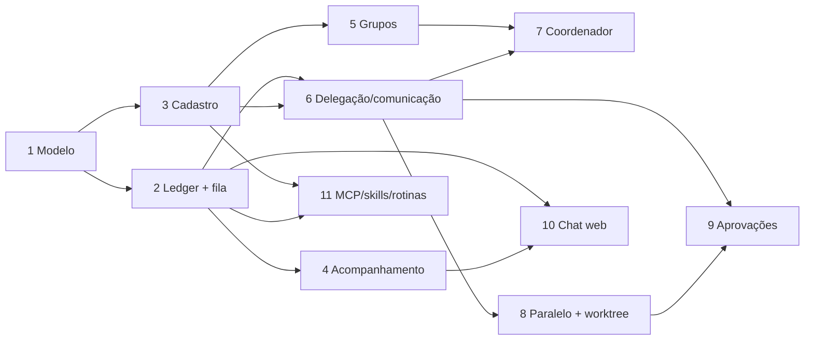

# Roadmap proposto para a Epic #296

> **Superado** pelo [roadmap da proposta arquitetural](../../architecture/multi-agent-platform/IMPLEMENTATION_ROADMAP.md),
> que reordena as etapas (worktrees antes de grupos, gateway depois da delegação) e fecha as decisões em aberto
> aqui (banco, schema, estados). Mantido como registro do raciocínio da pesquisa.

Proposta para revisão humana. Nenhuma Issue foi aberta. Cada etapa entrega algo utilizável pelo Telegram antes da
próxima; nenhuma depende de chat web.

## Ordem recomendada e por que difere da inicial

| # | Etapa | Ordem inicial | Motivo da mudança |
| --- | --- | --- | --- |
| 0 | Concluir a investigação | 1 | — |
| 1 | Modelo de agentes, grupos e execuções (fechar o spike #297) | 2 | inclui o modelo de **execução**, não só de agente |
| 2 | **Ledger de execuções e fila durável** | — (nova) | delegação, aprovação e acompanhamento precisam sobreviver a reinício; hoje tudo é memória (AD-06/20). No concorrente, tudo o mais é construído sobre `agent_runs` + `outbox` |
| 3 | Cadastro e gestão de agentes | 3 | — |
| 4 | Acompanhamento mínimo (execuções ativas, parar com motivo) | 10 | barato depois da etapa 2 e necessário para depurar as etapas seguintes |
| 5 | Grupos | 4 | — |
| 6 | Delegação **e** comunicação entre agentes | 6 e 7 | no concorrente são o mesmo mecanismo (consulta rastreada); separar cria dois contratos |
| 7 | Coordenador | 5 | o coordenador é um agente que **usa** as ferramentas de delegação; sem elas, só roteia |
| 8 | Execução paralela controlada | 8 | — |
| 9 | Aprovações integradas | 11 | approvals da CLI já existem; o que falta (ações do D.A.N.T.E.) só aparece com delegação e paralelismo |
| 10 | Chat multiagente web | 9 | o Telegram atende até aqui; o chat web consome eventos persistidos que só existem após a etapa 2 |
| 11 | MCP, skills e rotinas | 12 | — |

## Etapas

### 1. Modelo de agentes, grupos e execuções — complexidade **baixa/média**

- **Objetivo**: responder as perguntas do #297 com uma proposta revisável e ADs novas.
- **Funcionalidades**: nenhuma de produção. Modelo conceitual: `AgenteRegistrado` (definição) ≠ `SessaoDeAgente`
  (processo upstream, existente) ≠ `Execucao` (unidade rastreável: um turno de sessão, um job one-shot, uma
  delegação, uma rotina) ≠ `Delegacao` (pedido entre agentes) ≠ `PedidoDeAprovacao`; `GrupoDeAgentes` com
  `VersaoDoGrupo`; autoridade de cada execução (pessoa, delegação com pessoa na raiz, rotina).
- **Dependências**: esta investigação; código de #32/#60.
- **Componentes**: `docs/context/ARCHITECTURE_DECISIONS.md` (novas AD), `docs/maintainer/ARCHITECTURE.md`.
- **Riscos**: superdimensionar; misturar Brain com orquestração (vetado pela #296/#297).
- **Critérios de aceite**: diagrama, modelo, matriz de falhas, segurança, sequência e lista enxuta de issues
  filhas aprovados por humano.
- **Testes**: não se aplica.

### 2. Ledger de execuções e fila durável — **média/alta**

- **Objetivo**: toda execução vira linha persistente com estado, passos e vínculo (agente, sessão, turno,
  repositório, solicitante), e trabalho assíncrono passa por uma fila no Postgres.
- **Funcionalidades**: entidade `Execucao` com máquina de estados por compare-and-set (`Pendente → EmExecucao →
  AguardandoAprovacao | AguardandoResposta → Concluida | Falhou | Cancelada`); `PassoDaExecucao` numerado;
  `FilaDeTrabalho` com lease, `FOR UPDATE SKIP LOCKED`, `ChaveDeDeduplicacao`, retries com backoff, devolução no
  shutdown; varredura de execuções órfãs após reinício (marcar como interrompidas, nunca relançar processo).
- **Dependências**: 1; fundação EF/UoW (AD-43) e PostgreSQL canônico (AD-34) — banco próprio do Worker ou schema
  separado, decisão da etapa 1.
- **Componentes**: Domain/Application (novo módulo `Execucoes`), Infrastructure (EF + SQL da fila), Worker (hosted
  service da fila; `SessionRegistry` e `JobRegistry` passam a registrar execuções).
- **Riscos**: transação aberta durante espera de processo (o concorrente auditou 350 pontos para evitar, ADR 0163);
  duplicar estado entre `SessionRegistry` e o ledger; tornar o Postgres obrigatório para quem não usa Brain.
- **Critérios de aceite**: reiniciar o Worker preserva histórico; execução interrompida aparece como tal; job
  enfileirado duas vezes com a mesma chave roda uma vez; dois workers não pegam o mesmo item.
- **Testes**: unidade da máquina de estados (transição ilegal lança); integração com Postgres de teste
  (`dante-postgres-test`) para lease, expiração, `SKIP LOCKED` concorrente, dedupe; regressão das sessões atuais.

### 3. Cadastro e gestão de agentes — **média**

- **Objetivo**: agentes nomeados e configuráveis, separados das sessões.
- **Funcionalidades**: `AgenteRegistrado` (handle único e estável, nome, papel, instruções, driver Claude/Codex,
  modelo/esforço validados pela CLI como na AD-25/26, perfil padrão, servidores MCP permitidos, estado ativo);
  comandos Telegram para listar, criar, editar, ativar/desativar; leitura pela WebApi; sessão nova a partir de um
  agente registrado; `/claude` e `/codex` continuam como agentes implícitos.
- **Dependências**: 1. A etapa 2 não é obrigatória para o cadastro em si.
- **Componentes**: Domain `Agentes` (hoje só `AgentKind`), Application CRUD (AD-39), Infrastructure, Worker
  (`AgentContextResolver`, `SessionRegistry`), Telegram.
- **Riscos**: quebrar AD-27 (precedência determinística); instruções do agente conflitando com
  `ContratoDaConversaParaAgentes`.
- **Critérios**: criar, editar, desativar (sessões ativas seguem até encerrar; nenhuma nova), handle duplicado
  recusado, nenhum segredo no cadastro.
- **Testes**: validators, AppService, resolução de agente registrado × `/claude` × padrão; sessão criada recebe
  modelo/perfil/instruções do agente.

### 4. Acompanhamento mínimo — **baixa/média**

- **Objetivo**: ver o que roda e parar com previsibilidade.
- **Funcionalidades**: comando de execuções ativas/encerradas hoje (agente, repositório, estado, passo atual,
  esperando o quê); cancelar com motivo, que entra no contexto do próximo turno do agente ("sua tarefa X foi
  parada por Y"); lista "esperando você" (aprovações e perguntas pendentes).
- **Dependências**: 2.
- **Componentes**: Application `Execucoes` (consultas), Telegram, WebApi (leitura).
- **Riscos**: expor conteúdo sensível nas listas — mostrar só fatos (o concorrente separa fatos de conteúdo).
- **Critérios**: toda execução ativa aparece; cancelar encerra o processo (AD-17/63) e registra quem e por quê.
- **Testes**: consultas por estado; cancelamento com motivo; redaction.

### 5. Grupos — **média**

- **Objetivo**: grupos de execução, não só visuais.
- **Funcionalidades**: `GrupoDeAgentes` (nome, coordenador, participantes com papel, política: quem pode ser
  acionado, paralelismo máximo, repositórios permitidos); versão imutável referenciada pela execução; validação de
  papéis contraditórios (um agente com dois papéis exclusivos, coordenador fora do grupo).
- **Dependências**: 3.
- **Riscos**: composição dinâmica cedo demais (a #296 pede estática primeiro).
- **Critérios**: alterar o grupo não altera execuções já iniciadas; grupo inválido é recusado.
- **Testes**: invariantes do domínio; versão congelada.

### 6. Delegação e comunicação entre agentes — **alta**

- **Objetivo**: um agente pede trabalho ou informação a outro, de forma rastreada e limitada.
- **Funcionalidades**: entidade `Delegacao` (solicitante, executor, tipo pergunta/repasse, cadeia, estado,
  resposta, prazo prorrogável enquanto há trabalho); servidor MCP `dante_coordenacao` com `consultar_agente` e
  `delegar_tarefa` (padrão da AD-56); a resposta volta uma vez e acorda a sessão do solicitante como mensagem
  correlacionada; regras: sem autoconsulta, sem ciclos, profundidade máxima (ex.: 3), sem repassar o que a pessoa
  já pediu ao outro, máximo de delegações por execução; autoridade da pessoa na raiz; resultado de outro agente
  entra como dado não confiável com autor.
- **Dependências**: 2, 3.
- **Componentes**: Application `Delegacoes`, Worker (servidor MCP, `SessionRegistry` para acordar sessões),
  drivers (nenhuma mudança de protocolo esperada).
- **Riscos**: duas sessões no mesmo repositório escrevendo (bloquear escrita até a etapa 8: executor de delegação
  em perfil somente leitura ou em General Mode); limites de plano das CLIs; loops.
- **Critérios**: pergunta e resposta rastreadas; reinício no meio preserva o estado; ciclos e profundidade
  recusados com mensagem clara; o usuário vê quem fez o quê.
- **Testes**: casos de uso com drivers falsos (`FakeSessionDriver`); MCP; E2E com duas sessões simuladas;
  `Live*EvidenceTests` opt-in com CLIs reais.

### 7. Coordenador — **média**

- **Objetivo**: uma mensagem a um grupo é tratada pelo coordenador, que decompõe, delega e consolida.
- **Funcionalidades**: endereçar um grupo (`@grupo`) aciona o coordenador; instruções de coordenação geradas a
  partir do grupo (participantes, papéis, ferramentas de delegação); plano visível como checklist; resposta final
  com atribuição por participante e divergências explícitas; recibo "coordenado por X".
- **Dependências**: 5, 6.
- **Riscos**: coordenador que não delega ou delega demais; custo de plano. Mitigar com limites da etapa 6.
- **Critérios**: tarefa ao grupo produz delegações rastreáveis e resposta consolidada que cita quem contribuiu.
- **Testes**: cenários com drivers falsos programados; regra de roteamento ao grupo determinística.

### 8. Execução paralela controlada — **alta**

- **Objetivo**: paralelismo onde é seguro.
- **Funcionalidades**: limites globais, por agente e por repositório; worktree por execução de escrita (criado,
  preparado com arquivos ignorados necessários, removido), escrita sequencial no mesmo repositório, leitura em
  paralelo; identidade Git por agente (`GIT_CONFIG_GLOBAL`) e prefixo de branch; detecção de "mesmo alvo" (PR,
  issue) para não haver dois agentes atuando nele (ideia das team actions).
- **Dependências**: 6; contenção AD-63.
- **Riscos**: disco, conflitos, limites de plano simultâneos, interação com repositórios vinculados (AD-58).
- **Critérios**: duas escritas no mesmo repositório nunca simultâneas no mesmo checkout; limites respeitados;
  worktree removido ao fim.
- **Testes**: integração com repositório Git temporário; concorrência da fila; limites.

### 9. Aprovações integradas — **média**

- **Objetivo**: aprovações do próprio D.A.N.T.E. persistidas e ligadas à execução e ao passo.
- **Funcionalidades**: `PedidoDeAprovacao` com hash dos parâmetros, validade, decisor, execução única,
  reconferência de permissão na execução, ordem preservada; ações do D.A.N.T.E. que pedem (delegar com escrita,
  publicar artefato, merge quando existir); approvals da CLI continuam como hoje, mas registrados no ledger;
  recusa com motivo vira candidato no Brain.
- **Dependências**: 2, 6, 8.
- **Riscos**: dois sistemas de aprovação divergindo; mitigar com um contrato único de exibição no Telegram.
- **Critérios**: aprovação expira, não executa duas vezes, não executa com parâmetros diferentes, sobrevive a
  reinício.
- **Testes**: hash, expiração, execução única, revogação entre pedido e execução.

### 10. Chat multiagente web — **alta**

- **Objetivo**: interface para acompanhar o trabalho dos agentes além do Telegram.
- **Funcionalidades**: WebApi com leitura de agentes, grupos, execuções, delegações, aprovações; stream de eventos
  (SSE ou SignalR) a partir do ledger; UI mínima (lista de conversas/execuções, linha do tempo de uma tarefa,
  cartões de aprovação); autenticação própria.
- **Dependências**: 2, 4 (e 6/9 para conteúdo útil).
- **Riscos**: escopo de frontend; autenticação; expor o Worker na rede (manter loopback/Tailscale).
- **Critérios**: o que aparece no Telegram aparece na web com o mesmo estado.
- **Testes**: contrato da API, autorização, eventos.

### 11. MCP, skills e rotinas — **média**

- **Objetivo**: ampliar ferramentas por agente e trabalho agendado.
- **Funcionalidades**: concessão de servidores MCP por agente registrado com catálogo que nega o desconhecido;
  registro de skills só se houver agentes sem repositório; rotinas (cron e evento, incluindo eventos da #234)
  como execuções com autoridade "rotina", entrega explícita e política restrita.
- **Dependências**: 2, 3; #234 para eventos de CI.
- **Riscos**: rotina agindo com autoridade do criador (o problema que motivou a ADR 0053); ruído.
- **Critérios**: rotina nunca concede mais que o agente tem; falhas não ficam silenciosas.
- **Testes**: política por tipo de execução; disparo, sobreposição e coalescência.

## Próxima atividade sugerida para a Epic #296

**Fechar o spike #297** usando esta investigação como insumo: escrever a proposta arquitetural (entregáveis 1–10
da #297) com foco no modelo `AgenteRegistrado` / `Execucao` / `Delegacao` / `GrupoDeAgentes` e na decisão
sobre o ledger de execuções (banco, schema, convivência com AD-06/AD-20), e submeter para revisão. As primeiras
issues filhas, depois da aprovação, seriam a etapa 2 (ledger + fila) e a etapa 3 (cadastro), que podem andar em
paralelo.
